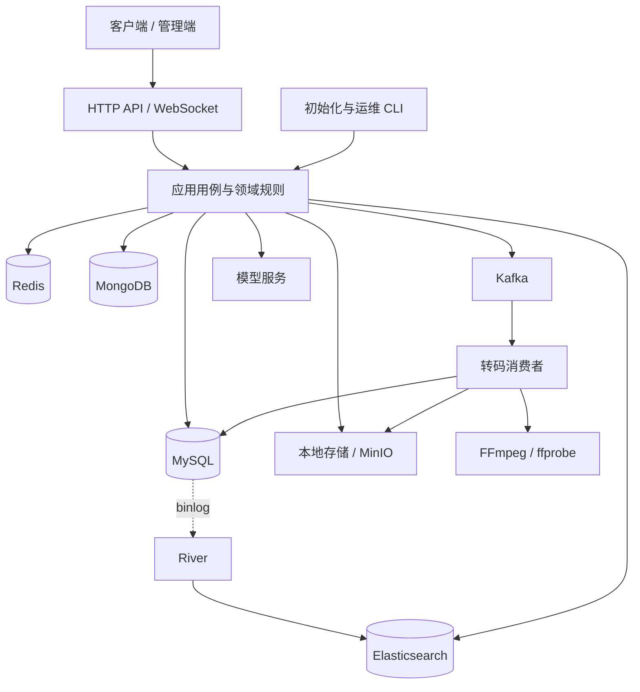

# CCG Video Backend

基于 Go 与领域驱动设计（DDD）的视频社区后端，覆盖视频投稿、异步转码、内容互动、实时通信、搜索与运营管理。

项目采用按业务上下文组织的分层单体架构，以 Gin 提供 HTTP API，通过 Wire 完成编译期依赖注入。转码任务由 Kafka 驱动，支持在服务进程内处理，也支持部署独立消费者。

[功能概览](#功能概览) · [系统架构](#系统架构) · [快速开始](#快速开始) · [开发与验证](#开发与验证) · [文档](#文档)

## 功能概览

| 模块 | 主要能力 |
| --- | --- |
| 用户与身份 | 账号注册、密码与第三方登录、访问令牌与刷新令牌、交互验证码、登录限流、用户封禁与状态管理 |
| 视频与创作 | 分片上传与续传、上传配额、分 P 投稿、改稿、内容审核、定时发布、播放记录与收藏夹 |
| 媒体处理 | 视频元数据探测、多清晰度 MP4、MPEG-DASH 自适应流、CPU / NVIDIA GPU 转码、进度跟踪、断点恢复与任务取消 |
| 社区互动 | 评论与回复、弹幕、点赞与投币、关注、动态、站内通知与 WebSocket 私信 |
| 搜索与发现 | 用户与视频关键词检索、搜索建议、热词、向量检索与以图搜视频、MySQL binlog 增量同步 |
| AI 扩展 | 流式对话、图片生成与编辑、视频生成、站内视频检索辅助；需配置相应模型服务 |
| 运营与权限 | 用户与内容管理、角色与菜单、接口资源授权、站点配置、统计与轮播图管理 |

## 系统架构

业务按 `identity`、`video`、`media`、`comment`、`social`、`chat`、`search`、`rbac` 等上下文组织。HTTP、WebSocket、CLI 与后台任务复用应用层用例；基础设施通过接口提供持久化、缓存、消息和外部服务能力。



转码消费者默认随 HTTP 服务启动。需要隔离转码资源时，可关闭 HTTP 节点的本地消费，并运行 `cmd/transcode-consumer`；跨节点须共享数据库、消息队列和源文件存储。River 按配置启用，用于关键词搜索索引的增量同步。

写侧以 MySQL 事务保存业务状态，读侧通过查询接口组装页面模型。搜索索引与异步转码独立推进，投稿保存、审核发布与媒体可播放各有自己的完成条件。完整依赖关系和运行流程见[架构说明](docs/architecture.md)。

### 技术栈

| 类别 | 技术 |
| --- | --- |
| 开发语言与接口 | Go、Gin、Gorilla WebSocket |
| 架构与装配 | DDD 分层、接口与适配器、Google Wire |
| 持久化与缓存 | MySQL、GORM、MongoDB、Redis |
| 搜索与消息 | Elasticsearch、go-mysql-elasticsearch（River）、Kafka / Sarama |
| 媒体与存储 | FFmpeg / ffprobe、本地文件系统、MinIO |
| 鉴权与权限 | JWT、Casbin RBAC |
| 配置与日志 | Viper、fsnotify、Zap |
| AI 集成 | Eino、模型服务适配器、多模态向量检索 |

### 项目结构

```text
.
├── cmd/
│   ├── server/                 # HTTP 服务与初始化任务入口
│   └── transcode-consumer/     # 独立转码消费者入口
├── internal/
│   ├── domain/                 # 领域模型、规则与仓储接口
│   ├── application/            # 应用用例、DTO 与协作端口
│   ├── infrastructure/         # 数据库、缓存、消息、存储与外部服务适配
│   ├── interfaces/             # HTTP、WebSocket 与 CLI 接口
│   ├── bootstrap/              # Wire 装配与进程生命周期
│   └── config/                 # 配置结构与校验
├── pkg/                        # 通用工具与协议辅助
├── conf/                       # Casbin 权限模型
├── init_resource/              # 初始化 SQL 与图片资源
├── docs/                       # 架构说明与接口文档
├── config.example.yaml         # 应用配置示例
└── docker-compose.yaml         # 本地依赖服务参考配置
```

## 快速开始

以下步骤在项目根目录执行，面向首次搭建的开发环境。

### 1. 准备环境

- **Go**：版本要求见 [go.mod](go.mod)，安全基线为 `1.27.3`；生产构建与开发验证均使用该版本或更新的安全补丁版本。
- **数据与消息服务**：MySQL、Redis、MongoDB、Elasticsearch 和 Kafka。Compose 中的参考版本分别为 MySQL 8.0、Redis 7.0、MongoDB 8.0、Elasticsearch 8.12.2 和 Kafka 3.9.0。
- **搜索插件**：Elasticsearch 需安装与其版本匹配的 IK 与 Pinyin 插件，供[关键词索引映射](internal/interfaces/cli/mappings/videos_mapping.json)使用。
- **媒体工具**：安装 `ffmpeg` 和 `ffprobe` 并加入 `PATH`；CPU 转码需支持 `libx264`，GPU 转码需具备 NVIDIA 驱动及 NVENC 支持。
- **文件存储**：按环境选择本地目录或 MinIO，配置中启用对应存储驱动。

[Compose 清单](docker-compose.yaml)可作为本地依赖部署参考。它引用的 `components/` 挂载配置、插件和数据目录未随仓库分发，使用前需自行准备。使用其中的 MinIO 服务时，还需创建外部数据卷：

```sh
docker volume create f_ccg_video_minio_data
```

启动依赖前，请将 Kafka 的 `KAFKA_ADVERTISED_LISTENERS` 外部地址改为应用实际可达的宿主机地址，并同步应用的 `kafka.brokers`。现有 Compose 中的局域网地址和开发凭据需按自己的环境调整。

### 2. 获取代码与依赖

```sh
git clone https://github.com/FlameCCG/f_ccg_video_back_ddd.git
cd f_ccg_video_back_ddd
go mod download
```

将 [config.example.yaml](config.example.yaml) 复制为 `config_dev.yaml`。Linux / macOS 可执行：

```sh
cp config.example.yaml config_dev.yaml
```

Windows PowerShell 可执行：

```powershell
Copy-Item config.example.yaml config_dev.yaml
```

### 3. 配置应用

按配置文件中的注释填写以下内容：

| 配置项 | 配置要求 |
| --- | --- |
| `mysql`、`redis`、`mongo`、`es` | 填写可达地址、端口与凭据，并预先创建 MySQL 业务数据库 |
| `jwt` | 分别设置访问令牌与刷新令牌签名密钥，每个至少 32 字符，替换示例值 |
| `kafka` | 配置 broker、转码 topic 与消费组；视频转码需要启用 Kafka |
| `site.storage` | 选择并配置存储驱动；本地目录须可写，MinIO 地址须可供服务及消费者访问 |
| `transcode` | 根据硬件设置编码模式；无 NVIDIA GPU 的环境设置 `cpuMode: true`、`gpuMode: false` |
| `server` | 配置监听地址与前端 CORS Origin |
| `email`、`thirdLogin`、`ai` | 使用邮件、第三方登录或 AI 功能时配置对应服务，并按需调整登录方式开关 |
| `river` | 需要增量同步时启用，配置同步规则、MySQL binlog 与复制账号权限 |

`config_dev.yaml` 已在 Git 忽略规则中，供本地保存环境配置。对外部署时应使用独立凭据、明确的 CORS 白名单和受控的依赖服务访问范围。

### 4. 初始化资源

确认依赖服务可用后，在**新建开发环境**中执行以下命令。请将示例用户名和密码替换为自己的管理员凭据：

```sh
go run ./cmd/server -f config_dev.yaml -all admin 'YOUR_STRONG_PASSWORD'
```

该命令依次迁移数据库、导入视频分区、上传初始化图片、重建关键词索引、同步接口资源、初始化 RBAC 并创建超级管理员。

**`-all` 包含索引删除与重建，会影响已有搜索数据。** 日常维护可按需使用单项任务：

| 参数 | 用途 |
| --- | --- |
| `-db` | 迁移数据库表结构 |
| `-vp` | 初始化视频分区 |
| `-br` | 上传并初始化横幅与轮播图资源 |
| `-es` | 删除并重建用户与视频关键词索引 |
| `-rs` | 同步接口资源清单 |
| `-rbac` | 初始化默认角色与菜单权限 |
| `-su <用户名> <密码>` | 创建或更新超级管理员 |

### 5. 启动服务

```sh
go run ./cmd/server -f config_dev.yaml
```

示例配置监听 `http://localhost:8080`，HTTP API 前缀为 `/v1`。接口路径、鉴权方式和字段定义见[接口文档](docs/openapi-md/index.md)与 [OpenAPI](docs/openapi.yaml)。

### 独立运行转码消费者

在 HTTP 节点将 `transcode.localConsumerDisabled` 设置为 `true` 并重启，然后在消费节点执行：

```sh
go run ./cmd/transcode-consumer -f config_dev.yaml
```

同一消费组内的实例按 Kafka topic 分区分摊任务。跨机器部署时，源文件及产物存储必须可共享访问。节点角色、必填配置和启动方式见[架构说明](docs/architecture.md#63-独立转码入口与节点角色)。

## 开发与验证

构建两个进程入口：

```sh
go build ./cmd/server ./cmd/transcode-consumer
```

运行测试与静态检查：

```sh
go test ./...
go vet ./...
```

测试包含领域规则、应用用例、路由清单、架构依赖和媒体封装等检查。涉及 FFmpeg 或其他环境依赖的测试，请同时查看运行结果中的跳过项。

安全检查与 CI 使用同一命令：

```sh
go install golang.org/x/vuln/cmd/govulncheck@v1.9.0
govulncheck ./cmd/server ./cmd/transcode-consumer
```

2026-10-26 在 Go 1.27.3 下扫描两个入口：静态可达漏洞 0 项、已导入包漏洞 0 项。模块级仍会提示 [GO-2026-5932](https://pkg.go.dev/vuln/GO-2026-5932)：`x/crypto/openpgp` 无修复版本。两个入口的依赖图均未导入该包；本项目使用同模块的 `bcrypt`，保留此提示且不屏蔽后续扫描。

修改 Wire provider 或接口绑定后，重新生成装配代码：

```sh
go run -mod=mod github.com/google/wire/cmd/wire ./internal/bootstrap
```

生成结果位于 `internal/bootstrap/wire_gen.go`，普通构建可直接使用仓库中的生成文件。

## 文档

| 文档 | 内容 |
| --- | --- |
| [架构说明](docs/architecture.md) | 上下文划分、分层依赖、配置、生命周期与业务链路 |
| [HTTP API 导航](docs/openapi-md/index.md) | 普通用户与管理员接口说明 |
| [OpenAPI 定义](docs/openapi.yaml) | 接口路径、请求参数与响应结构 |
| [独立转码入口](docs/architecture.md#63-独立转码入口与节点角色) | 转码进程启动、节点角色与跨机器配置 |
| [交互架构图](docs/diagrams/system-architecture.html) | 运行时组件与调用链，下载后用浏览器打开 |
