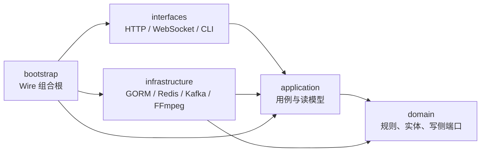
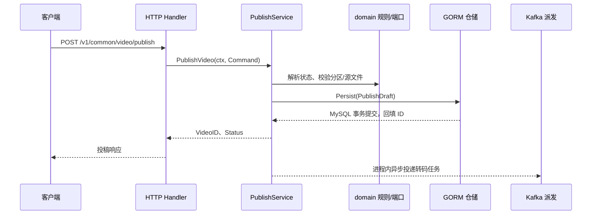

# 从零读懂本项目的 DDD 架构

> 这是一份**源码导读**，不是 DDD 术语手册。目标是：拿到一个接口，能说出它属于哪个业务边界、规则在哪里、数据怎么落库、外部依赖在哪里接入，以及失败时哪些结果已经提交。内容按当前工作树编写；以后代码变化时，以源码为准。

本文把三种内容分开标注：**当前实现**来自仓库源码；**教学示例**只用于解释概念；**演进建议**需要额外设计和实现，不能当作项目已完成的能力。面试时也要分清“现有代码做到了什么”和“我会怎样改进”。

建议按顺序读：零基础先读第 0～4 节，打开源码走完第 5 节，再读第 6～11 节理解设计取舍，最后做第 12～18 节练习与口述。不需要先学完 Go 的所有框架。媒体处理细节在[架构与媒体原理](./interview/02-架构与媒体原理.md)，系统运行总览在[架构说明](./architecture.md)，[交互架构图](./interview/diagrams/system-architecture.html)画的是运行时依赖，和本文的**代码依赖图**观察角度不同。

### 阅读导航

| 你现在的问题 | 阅读位置 | 读完应能做什么 |
|---|---|---|
| 我连请求、数据库、业务规则都分不清 | [0. 预备知识](#ddd-0) → [1. DDD 动机](#ddd-1) | 用自己的话讲出一次投稿的几个阶段 |
| 术语太多，容易混 | [2. 术语](#ddd-2) → [3. 两张地图](#ddd-3) → [4. 对象](#ddd-4) | 区分上下文、层、实体、PO、DTO、聚合 |
| 一次请求到底经过什么 | [5. 投稿主线](#ddd-5) → [6. 规则定位](#ddd-6) | 找到入口、规则、端口、实现和提交点 |
| 接口为什么能调用具体实现 | [7. Go 接口教学](#ddd-7) → [8. 跨上下文](#ddd-8) → [11. Wire](#ddd-11) | 解释运行时调用与源码依赖的区别 |
| 哪些能一起回滚，哪些不能 | [9. 事务与故障](#ddd-9) → [10. 读模型](#ddd-10) | 判断数据库、消息、缓存和搜索的保证 |
| 我要独立改需求或准备面试 | [12. 上传练习](#ddd-12) → [13. 定位方法](#ddd-13) → [14. 自测](#ddd-14) | 能按事实定位代码，不只背术语 |
| 我想系统练习和检查理解 | [15. 判断清单](#ddd-15) → [16. 学习路径](#ddd-16) → [17. 面试回答](#ddd-17) → [18. 改需求练习](#ddd-18) | 说清理由、失败边界、验证方式与代价 |

<a id="ddd-0"></a>

## 0. 小白先准备五个概念

不用先记 DDD。假设你在视频网站点“发布”，你真正想要的是：“系统保存我这份稿件，并按规则处理它。”下面五个词只是把这件事拆开描述。

| 概念 | 在投稿中的白话含义 | 常见误解 |
|---|---|---|
| 请求 | 浏览器把标题、分区、上传哈希等发送给服务器 | 一次请求不代表整个视频处理已经完成 |
| 用例 | 系统为了完成“投稿”这个目标组织的一串步骤 | 用例不是一个数据库表，也不是一个 HTTP 路由字符串 |
| 规则 | 私密稿不能公开，分区必须允许投稿，待审稿不能到点自动公开 | 请求字段不为空只是部分校验，不能替代业务规则 |
| 持久化 | 把需要长期保存的事实写到 MySQL 等存储中 | Go 变量赋值或 goroutine 启动不算可靠持久化 |
| 异步 | 请求不等待后台工作完成，后台工作可以与响应返回并发 | 异步任务仍会失败，进程重启也可能让未完成任务丢失 |

几个 Go 名词也只需先懂到这个程度：`struct` 是装相关数据的类型；方法是挂在类型上的行为；`interface` 表示调用方需要哪些方法；`context.Context` 传递超时、取消和请求相关信息；`error` 表示操作没能成功完成。**接口本身不会连数据库，也不会自动创建对象**，具体对象由构造和装配代码提供。

从这张“用户视角的时间线”开始理解整个项目：

```text
上传源文件完成
    → 提交投稿请求
    → 校验分区、源文件、额度，确定稿件状态
    → MySQL 提交稿件、关联数据及定时计划
    → 调用 tasks.Go 安排后台工作，之后不等待后台完成
       ├─ 同步路径：返回稿件 ID 和状态 → Handler 返回 HTTP 响应
       └─ 后台路径：同步向量、投递转码等任务
                    → 消费者生成产物、补充资源信息
                    → 详情/搜索按各自规则与数据链路展示结果
```

这是一条帮助理解的主线，`tasks.Go` 在用例 return 之前调用，后台实际执行与响应返回的先后不确定。后续动作可能并行、重试或失败。假如关闭审核并立即发布，稿件状态可能在转码完成前就是 `Published`；所以“已公开”与“有某档转码产物”必须分别判断。后文会把每一步对应到文件。

<a id="ddd-1"></a>

## 1. 先用一句话理解 DDD

DDD（领域驱动设计）首先问的是：**业务里的“视频、投稿、审核、封禁、转码”各是什么意思，谁负责制定规则，哪些规则必须始终成立？** 然后让代码的名字、边界和依赖围绕这些业务事实组织。

它有两个互相关联的层面：

| 层面 | 解决的问题 | 在本项目中的位置 |
|---|---|---|
| 战略设计 | 业务有哪些边界？同一个词在不同业务里是否同义？边界之间怎样协作？ | `identity`、`video`、`media`、`search` 等上下文，以及 `bootstrap/adapters` |
| 战术设计 | 一个边界内部如何表达实体、业务规则、仓储与用例？ | `internal/domain/<ctx>`、`internal/application/<ctx>`、对应的基础设施实现 |

**最容易混淆的一点：DDD 不等于四层目录。** `domain`、`application`、`infrastructure`、`interfaces` 是让业务模型不被 Gin/GORM/Redis 绑死的一种组织方式；限界上下文是业务语义边界。两者分别回答“按什么业务划分”和“代码依赖往哪走”。本项目把这些边界放在同一个 Go 进程里，属于按上下文拆包的单体应用，不是微服务。

先拿投稿举例：

- “未来时间且开启审核时，先进入待审状态”是**业务规则**，在[领域规则](../internal/domain/video/status_resolve.go)里。
- “查分区、验证源文件、组织投稿数据、提交后派发转码”是**用例编排**，在[投稿服务](../internal/application/video/publish_service.go)里。
- “怎样用 GORM 写 `videos`、标签、分 P 和资源行”是**技术实现**，在[投稿仓储](../internal/infrastructure/persistence/video/publish_repo.go)里。
- “从 JSON 拿哪些字段、从 JWT 取谁在投稿、怎样返回 HTTP 响应”是**协议处理**，在[投稿 Handler](../internal/interfaces/http/handler/video/publish.go)里。

这四句能说清，就有了读本项目 DDD 的起点。

### 1.1 为什么要费力分层：从一个不断变大的投稿函数说起

**教学情境：** 最初只有一个接口，Handler 中直接读取 JSON、检查分区、决定状态、调用 GORM、发送 Kafka 消息，几十行也能完成。后来增加了私密稿、内容审核、定时发布、多分 P、上传额度和清理任务，问题就变成了：

- 定时发布也需要决定“能不能公开”，是否要复制 Handler 中的判断？
- 想测试“待审稿到点仍不能公开”，是否必须先启动 HTTP、MySQL、Redis 和 Kafka？
- 想改变存储方式，为什么投稿状态判断也得跟着改？
- 数据库已经提交而发消息失败，该返回什么，重试会不会再建一份稿件？

DDD 的收益在于让**业务概念、规则和一致性边界能够单独辨认**。本项目把状态解析抽成领域纯函数，把步骤组织放在应用服务，把落库和发消息放在适配器中，因此这些问题能沿不同边界分别检查。代价是文件更多、构造和转换更多，读者需要学会沿用例追踪。

### 1.2 和传统 Controller → Service → DAO 有什么不同？

传统三层也可以写得很好，DDD 也可以写得混乱。区别不在目录数量，而在**是否围绕业务建模、是否保护规则以及谁依赖谁**。

| 观察点 | 常见的三层写法 | 本项目采用的做法 | 这样做解决什么 |
|---|---|---|---|
| 业务如何拆分 | 按 Controller、Service、DAO 分目录，业务边界可能不显式 | 每层内部再按 `video`、`media`、`identity` 等上下文组织 | 先确定谁拥有审核、转码、账号状态等规则 |
| 状态规则 | 可能写在某个庞大的 Service 的条件分支中 | 用领域状态解析函数表达，并显式传入时间/开关 | 其他入口能复用，规则能直接测试 |
| 数据对象 | 一个带 ORM tag 的结构兼做请求、查询和业务对象 | `domain.Video`、`po.Video`、详情 DTO 分开 | 表结构与接口需求变化不必都穿透到业务对象 |
| 持久化依赖 | Service 经常直接依赖具体 DAO 或全局 DB | 用例依赖端口，基础设施实现端口 | 测试替换依赖，业务流程不直接 import 实现 |
| 成功的含义 | 容易把“函数返回 nil”当成全链路成功 | 区分 MySQL 已提交、Kafka 已入队、产物可用、公众可见 | 排障和接口承诺更精确 |

这个表描述的是常见情况，不是规定三层一定有这些缺点。完全可以在三层结构中使用 DDD 思想，也可以用四层目录继续把所有规则堆在 Service。

### 1.3 什么时候值得用，什么时候要控制复杂度？

视频业务有多种状态、权限、异步媒体处理和跨存储协作，明确模型和边界有实际价值。若一个功能只是简单维护配置字典，没有复杂规则，不必先造聚合、领域事件总线和多层通用工厂。适合的做法是：先写清真实规则和变化点，再决定需要哪些抽象。

DDD 本身不是 Gin/GORM 那样需要安装的框架，也没有规定必须使用 Wire、微服务、消息队列或事件溯源。本项目用这些工具实现其具体需求；换工具之后，业务规则仍应能辨认。

<a id="ddd-2"></a>

## 2. 把常见术语翻译成本项目里的东西

| 术语 | 白话解释 | 本项目的例子 | 需要避免的误解 |
|---|---|---|---|
| 领域（domain） | 要解决的业务问题和规则 | 视频能否投稿、稿件是否公开、分区能否接受投稿 | 不是 `domain/` 目录里所有结构体都自动变成“高级 DDD 模型” |
| 通用语言 | 产品、开发、测试对同一概念使用一致名字 | 投稿、分 P、源资源、待审核、定时发布、转码任务 | `已投稿`、`已入队`、`可播放`、`已公开`不是同一个状态 |
| 限界上下文 | 一组概念在其中有稳定含义和责任归属 | `video` 管稿件；`media` 管转码与媒体任务；`identity` 管账号 | 不等于独立进程，也不一定一一对应数据库 |
| 实体 | 有持续身份、状态会变化的业务对象 | [Video](../internal/domain/video/video.go) 有 `ID`、`Status`，可判断是否已发布 | 不等于 GORM 表结构；同一实体不必装下全部表字段 |
| 值对象 | 主要按内容表达意义，通常不靠身份区分 | `StatsDelta` 表示一次计数变化；`ResourceDraft` 描述初始源资源 | 本项目并非所有此类结构都做成严格不可变类型 |
| 聚合 / 聚合根 | 一次一致性规则围绕的对象与入口 | `Video` 被注释为视频写侧聚合根；一次投稿以它为主体，附带标签、分 P、初始资源 | 不要把“整个视频站”视为一个聚合，也不要认为所有子表必须由一个超大结构体常驻内存 |
| 仓储（Repository） | 业务代码所需的持久化能力接口 | [domain.VideoRepository](../internal/domain/video/repository.go) 的 `Persist`、`EnsurePublished` 等 | 它不是 HTTP Repository，也不是“每张表自动生成一套 CRUD” |
| 应用服务 / 用例 | 把一个用户目标所需的步骤组织起来 | [PublishService.PublishVideo](../internal/application/video/publish_service.go) | 不应把所有规则塞进 Handler，也不应把 Kafka 调用塞进纯领域函数 |
| 端口 / 适配器 | 一边声明“需要什么能力”，另一边接具体技术 | `VideoRepository` ← GORM；`TranscodeDispatcher` ← media 适配器 | “有接口”本身不是目的，边界和替换方向才是目的 |
| 组合根 | 程序启动时选择并连接具体实现 | [bootstrap 的 Wire 绑定](../internal/bootstrap/providers_contexts.go) | 组合根负责接线，不应承载投稿业务规则 |
| 读模型 | 为查询/响应准备的数据形状 | `DetailMeta`、`VideoDetail` 包含作者、标签、资源、当前用户互动标记 | 读模型不必和写侧 `Video` 结构一模一样 |

先不用背词。后面每个术语都会对应到调用链里的一个实际动作。

再补一个容易被术语带偏的点：**领域事件**通常描述“业务上已经发生的事实”，而任务命令描述“接下来请做什么”。项目里的[评论 LikeEvent](../internal/domain/comment/like_event.go)是 Redis 回写队列的具体消息契约；[TranscodeTask](../internal/domain/media/task.go)是请消费者执行转码的任务。它们都不能证明项目已经实现完整的领域事件总线或事件溯源。看消息时先问“这是事实通知，还是待执行命令”，再看失败重试和落库位置。

### 2.1 战略设计先做什么？先统一含义，再选边界

假设产品说“视频已经完成”，不要立刻建一个 `finished bool`。先追问业务含义：是源文件上传完成、投稿入库完成、转码完成，还是审核后公开？这些结论分别属于上传流程、稿件管理、媒体任务和可见性规则。一个模糊字段会把四个流程绑在一起。

可以把战略设计理解为下面三个步骤：

1. **统一语言。** 明确“稿件”“分 P”“源对象”“可播放资源”“待审”各指什么。代码、测试和接口说明都沿用这些定义。
2. **划定上下文。** 找到谁制定规则、谁维护权威状态。同样叫“状态”，视频审核状态和转码任务进度属于不同模型。
3. **画协作关系。** 明确哪边提出需求，哪边提供能力，中间怎样转换模型，失败后谁负责重试或补偿。

“子域”和“限界上下文”也不是同义词：子域是在分析业务问题，例如稿件管理、媒体加工、账号认证；限界上下文是在限定某套模型的语义和实现责任。二者经常对应，但没有要求一一映射。**核心域、支撑域、通用域**用于讨论业务竞争力和投入优先级，不是文件夹等级。没有产品战略资料时，不能只看代码就断言哪个域一定是公司的核心域。

你可以为当前项目画一个入门上下文地图：

```text
identity / rbac：提供身份、角色与账号状态
          ↓ 经显式端口服务其他用例
video：维护稿件与可见性，提出转码需求
          ↓ TranscodeDispatcher + DTO 转换
media：接收媒体任务需求，使用存储/队列/转码能力

video 的数据变化 → 关键词/向量等派生链路 → search 查询
```

这是责任关系示意，不能当作完整运行时拓扑，也不能据此宣称每条连线都使用领域事件。实际索引链路、绑定和故障保证要继续读对应实现。

<a id="ddd-3"></a>

## 3. 两张地图：业务边界与代码依赖

### 3.1 业务边界：一个请求可能跨多个上下文

本项目的主要上下文包括：

| 上下文 | 它主要负责什么 | 先看哪个目录 |
|---|---|---|
| `identity` / `rbac` | 用户、登录、封禁；角色和权限 | `internal/application/identity`、`internal/application/rbac` |
| `video` | 投稿、稿件状态、详情、互动、弹幕、上传用例 | `internal/application/video`、`internal/domain/video` |
| `media` | 转码任务、进度、取消、媒体存储能力 | `internal/application/media`、`internal/domain/media` |
| `search` | 搜索查询、关键词/向量索引用例 | `internal/application/search` |
| `comment` / `social` / `dynamic` | 评论、关注、动态 | 同名的 `internal/application/<ctx>` |
| `chat` / `notification` | 私信会话与消息、站内通知 | 同名的 `internal/application/<ctx>` |
| `contentops` / `ai` / `platform` | 站点运营、AI 能力、后台维护用例 | 同名的 `internal/application/<ctx>` |

“投稿”主要由 `video` 负责，但源文件存储能力来自 `media`，转码投递也需要 `media`；搜索索引随后异步更新，定时发布意图则随稿件保存在同库视频行。**跨上下文协作是正常的，关键是别让一个上下文直接偷用另一个上下文的内部结构。** 具体接线可看[跨上下文 ProviderSet](../internal/bootstrap/providers_cross_context.go)。

边界按**谁定义语义和规则**划分，不是按“谁碰了这张表”划分。`videos`、`video_resources` 在业务上属于视频上下文；为了保持既有转码行为，[media 的资源仓储端口](../internal/domain/media/ports.go)仍会经 media 侧持久化适配器读写这些表。不要据此推断 media 拥有“稿件审核规则”，也不要因为两个包共用 MySQL 就宣布它们是同一个上下文。读这类交叉位置时，先问“为什么需要这项能力”，再找端口与适配器。

“资源”就是一个好例子：在 `video` 里，它偏向“详情中展示给用户的某档可播放资源行”；在 `media` 里，它偏向“转码任务实际生成并校验的文件”。两边有联系，但一个文件上传成功，不自动意味着资源行已写入，也不自动意味着稿件已公开。用上下文限定词把话说完整，调试时才不会把不同状态混在一起。

### 3.2 代码依赖：业务代码提出需求，外部代码提供实现



箭头在这里表示**源代码依赖**，不是网络流量。运行时，`PublishService` 会调用 GORM 仓储；但编译时，它只知道 `domain.VideoRepository` 接口，不 import GORM 实现。最终由 `bootstrap` 注入具体仓储。这就是“依赖倒置”。[架构约束测试](../internal/application/shared/arch_deps_test.go)检查 application 不 import infrastructure，以及 domain 不 import infrastructure/配置；测试能守住这些已编码的规则，但不能证明每个业务边界都设计得完美。

读源码时再问自己：这里是“谁**调用**谁”，还是“谁在 Go 文件里 **import** 谁”？这两个方向可能不同。

### 3.3 四层到底怎么判断：看动作，而不是只看名字

| 一段代码在做什么 | 更合适的职责位置 | 它一般不该承担什么 |
|---|---|---|
| 绑定 JSON、读取登录身份、把错误转成 HTTP 响应 | `interfaces` | 不直接决定所有稿件状态或组织多表持久化 |
| 为“投稿”目标查分区、查源文件、调用规则、提交和安排后续任务 | `application` | 不编写具体 GORM 查询或 Kafka 客户端调用 |
| 已知是否私密、发布时间、审核开关，计算应进入哪个状态 | `domain` | 不读取 Gin 请求或 YAML 配置 |
| 把草稿映射成 PO、执行 SQL、Lua、Kafka/MinIO/FFmpeg 调用 | `infrastructure` | 不拥有跨所有上下文的万能业务流程 |
| 构造具体对象并把实现交给端口 | `bootstrap` | 不承载每次投稿的条件分支 |

当你不知道某段判断放哪里时，问：**如果把 HTTP 换成后台任务，把 MySQL 换成另一种存储，这个判断是否仍然成立？** “待审稿不能自动公开”仍成立，偏领域；“如何把错误编码成 JSON”会变，偏接口；“如何原子写几张表”依赖技术，偏基础设施。这个问题帮助辨认职责，不能机械覆盖所有例外。

授权也有多个层次：路由上的“需要登录/管理员”是入口访问控制；“作者只能预览自己的私密稿”是用例/读取路径中的业务权限；“Redis 如何原子计算额度”是实现问题。只在 HTTP 中间件检查一次身份，不能证明所有应用入口都自动满足业务权限。

<a id="ddd-4"></a>

## 4. 先认目录，再认对象

```text
cmd/server/                         进程入口与退出码
internal/bootstrap/                 构造和生命周期：Wire、组件启动/关闭
internal/interfaces/http/           路由、中间件、Handler、HTTP 请求/响应
internal/application/<ctx>/         用例编排、查询端口、读模型、跨上下文端口
internal/domain/<ctx>/              业务对象、纯规则、写侧仓储接口
internal/infrastructure/persistence/ GORM/Mongo 与 PO、查询实现
internal/infrastructure/cache/      Redis 实现
internal/infrastructure/mq/         Kafka 与转码消费者适配
internal/infrastructure/storage/    本地/MinIO 文件驱动
internal/config/                    配置数据结构
```

认清同一个“Video”的三种形态尤其重要：

| 形态 | 文件 | 为什么存在 |
|---|---|---|
| 领域实体 `domain.Video` | [domain/video/video.go](../internal/domain/video/video.go) | 写侧需要的身份、状态和规则；没有 GORM tag |
| 持久化对象 `po.Video` | [persistence/po/video.go](../internal/infrastructure/persistence/po/video.go) | 映射 `videos` 表、列、关联和 GORM tag |
| 查询/响应 DTO `VideoDetail` | [application/video/dto.go](../internal/application/video/dto.go) | 为详情接口组织作者、分区、标签、资源、计数等字段 |

仓储在[converter.go](../internal/infrastructure/persistence/video/converter.go)中进行 PO ↔ domain 转换。一个数据库行、一个领域对象、一个 HTTP 响应可以描述同一视频，但它们服务的任务不同。**看到同名结构体先看包名与用途，不要直接认作重复代码。**

### 4.1 实体、值对象与聚合，逐个拿视频举例

**实体看身份。** 视频标题从“A”改成“B”，ID 不变，它仍是同一个视频；[Video](../internal/domain/video/video.go) 因此有 `ID` 和随时间变化的 `Status`。分 P 也有自己的 ID，是另一种实体。判断两个实体是否为“同一个”，优先看业务身份，而不是所有字段是否逐字相同。

**值对象看内容。** `StatsDelta{Views: 1}` 表示“播放量增加 1”，无需给这次增量另分配一个可追踪的视频身份；同样内容的两个增量在表达业务意义时可互换。[`StatsDelta`](../internal/domain/video/video.go) 在这里是一个值语义结构。严格的 DDD 教材常要求值对象不可变；当前 Go 结构体并未把所有字段做成私有不可变，读代码要区分“概念角色”和“语言层面的强制约束”。

**聚合看一致性入口。** 一次投稿围绕视频主体建立标签关联、分 P 和初始资源；[PublishDraft](../internal/domain/video/part.go) 收齐本次写入数据，仓储在同一 MySQL 事务中提交。`Video` 在代码注释中是写侧聚合根，但 `PublishDraft` 是一次投稿的**持久化草稿**，不是另一个“聚合根”，也不是事件。评论、私信、搜索索引和 FFmpeg 任务都不应该为了“属于这部视频”就塞进一个无限大的 Video 聚合；它们有不同的写入频率、一致性要求和故障边界。

用这三问来辨认：**它是否有持续身份？按值相等还是按 ID 相同？某条规则要求哪些数据在同一次提交里一起成立？** 不要从“有几个 struct、几张表”倒推聚合边界。还要承认当前仓储接口为了兼容既有业务包含许多操作，未必是一本教材里最小、最纯的聚合仓储。

### 4.2 不变量是什么，为什么它决定聚合边界？

不变量是“无论经过哪个允许的操作，都必须成立的业务条件”。它不是 Go 里的 `const`，也不等于某字段永远不能变。例如，视频可以从待审变为公开，但在当前规则下，**审核开启时，待审稿不能仅因定时任务到期就公开**。

| 条件/约束 | 当前主要保护位置 | 保证范围与限制 |
|---|---|---|
| 私密请求解析为 `Private` | `ResolvePublishVideoStatus` | 保护这条规则的调用结果；不自动禁止其他代码直接改字段 |
| 禁用/不可投稿分区不能用于这次投稿 | `Partition.EnsureSubmittable` + 投稿用例 | 基于查询到的分区事实；若要保证与并发禁用串行，需要额外并发设计 |
| 本次有效草稿中的数据库写入一起成功或回滚 | `Persist` 的 GORM 事务 | 涉及本次视频、标签关联、分 P、资源的 MySQL 写入，包含可选项 |
| 定时发布只从允许的原状态更新 | 领域判定 + `UpdateStatusFrom` 条件更新 | 再次检查数据库当前状态，避免只按旧快照覆盖 |
| 源对象验证后到投稿入库前，不被协作的清理流程删除 | 哈希锁 + `WithPublishUploads` | 依赖投稿和清理流程使用同一协调约定，不能约束存储外部手工删除 |

注意第三行不是“每次必须存在所有资源行”。`BuildInitialResourceDraft` 对空路径可返回 nil，草稿也允许没有标签或分 P；事务保证的是**实际写入项的原子性**，不会凭空补出业务数据。当前正常投稿路径会先解析已完成上传的对象路径，再组装源资源草稿。

聚合把需要一起维护的一组业务条件收拢到可控制的入口，因此通常要尽量小。假设把视频、所有评论、所有点赞、所有转码任务都放入一个聚合，每次点赞就可能与转码、评论写入争用同一边界，加载与事务成本也会扩大。仅仅“都有 video_id”不足以证明它们应该是同一个聚合。

### 4.3 领域建模不会自动解决并发

**教学场景：** 调度器先读取稿件是 `Scheduled`；管理员随后把稿件删除；调度器再无条件写 `Published`。即使前面的纯函数判断正确，也可能把删除结果覆盖。

本项目定时发布使用 [`UpdateStatusFrom`](../internal/domain/video/repository.go)：只有数据库当前状态仍等于预期的旧状态，才更新为公开，并检查影响行数。纯规则回答“哪些迁移允许”，条件更新回答“提交时那个事实是否还成立”。并发安全通常还需要事务、锁、版本号或唯一约束，不能只说“使用聚合根就解决了”。

另一个细节：`Video` 的字段公开，其他代码技术上可以给 `Status` 任意赋值。这份代码借助分层、规则函数和用例约定保护模型，并没有把所有写入封装成无法绕过的实体方法。面试时应据此谈模型封装的改进空间。

<a id="ddd-5"></a>

## 5. 跟着一次投稿，把四层走通

打开以下文件，按顺序往下读。路由入口在[video_router.go](../internal/interfaces/http/router/video_router.go)，真正的主线是：



> 时序图把最后一步画在响应之后，是为了强调**响应不等待 Kafka 成功**；异步 goroutine 的实际调度先后由运行时决定。不能把它当成跨 MySQL 与 Kafka 的原子事务。

1. **路由决定入口策略。** `POST /v1/common/video/publish` 经过请求超时、JWT、投稿开关、封禁检查和 JSON 绑定，再进入 Handler。这里的校验有协议层含义，例如 `binding:"required"`；后台权限、投稿暂停也在这一层拦截。见[路由](../internal/interfaces/http/router/video_router.go)。
2. **Handler 翻译协议。** `PublishVideoView` 从 `gin.Context` 取 uid/username，把 JSON 请求转成 `PublishVideoCommand`，调用应用服务，再把结果转成响应。`gin.Context` 没传进应用层。见[Handler](../internal/interfaces/http/handler/video/publish.go)。
3. **应用层编排业务步骤。** `PublishService` 根据请求时间、私密标志和内容审核配置调用 `ResolvePublishVideoStatus`；检查分 P 数量；对每个上传哈希取得锁，确认源对象存在、占用上传额度。这里的“按什么顺序做”是用例职责。见[投稿服务](../internal/application/video/publish_service.go)和[上传服务](../internal/application/video/upload_service.go)。
4. **领域层给出规则与数据形状。** `Partition.EnsureSubmittable()` 判断分区是否启用并允许投稿；`BuildInitialResourceDraft()` 描述源片初始资源；`PublishDraft` 表示这次投稿要一起写入的主体、发布时间、标签、分 P 和资源。见[分区实体](../internal/domain/video/partition.go)、[投稿草稿](../internal/domain/video/part.go)。
5. **仓储实现 MySQL 事务。** `VideoRepository.Persist` 用 GORM `Transaction` 写包含发布时间的 `videos`、标签关联、分 P 与初始资源；失败则回滚这些数据库写入，成功后回填视频/分 P ID。它实现的是领域接口中的 `Persist`，不是应用层直接 `gorm.Create`。见[接口](../internal/domain/video/repository.go)与[实现](../internal/infrastructure/persistence/video/publish_repo.go)。
6. **同步阶段结束，异步阶段开始。** MySQL 成功后，`DetachedTaskGroup` 执行向量同步和 Kafka 投递；定时计划已在投稿事务内保存；Kafka 投递成功后尽力写 `queued` 进度。失败只记录日志，不会回滚已经提交的稿件。见[投稿服务](../internal/application/video/publish_service.go)与[media 投递服务](../internal/application/media/dispatch_service.go)。

这条链路最重要的四种结论要分开说：**稿件已保存、转码已入队、产物已落库/可访问、公众可见**。它们不是一个状态。源资源行已在投稿事务中写入；消费者后来会用 ffprobe 补全媒体信息，再增加转码产物。详情和审核状态也要分别判断。

### 5.1 如果某一步失败，已经发生了什么？

| 失败点 | 已发生的事 | 该怎样理解 |
|---|---|---|
| 分区或源对象校验失败 | 投稿事务尚未成功 | 用户需要纠正输入或补完上传 |
| `Persist` 内任一步失败 | 该次 MySQL 事务回滚 | 不应出现“视频行已提交、同次初始资源行没提交” |
| MySQL 已提交、异步 Kafka 投递失败 | 稿件存在，任务可能未入队 | 当前没有事务 Outbox，单靠消费者重试补不了**入队前**的缺口 |
| Kafka 已入队、转码中途失败 | 原稿件和源资源仍存在 | 消费位点、检查点和资源去重用于重投；不表示数据库、Kafka、对象存储变成一个事务 |

这张表既是在学 DDD 的“边界”，也是日后排障时判断权威事实的起点。

### 5.2 一个具体请求：今晚定时公开，但现在还没审核

**教学输入，按当前规则推导：** 假设当前时间 18:00，用户请求 20:00 公开，`IsPrivate=false`，站点开启审核，源文件上传完成且分区可投稿。

1. 用例确定 20:00 是未来时间，把审核开关作为入参交给领域函数。
2. 初始状态得到 `Review`，不是 `Scheduled`，也不是 `Published`。
3. 本次稿件、20:00 的 `publish_at`、定时标记及关联数据通过 MySQL 事务保存。用户得到 ID 和待审状态。
4. 异步阶段同步向量并投递转码；成功保存不证明 Kafka 投递也已成功。定时意图不依赖这一步。
5. 若到了 20:00 仍是 `Review` 且审核开关仍开启，保留待审和原计划时间，**不会自动公开**；审核通过时再按计划时间决定立即或定时发布。

因此，“到点了”“转码完成了”“Kafka 消费成功了”都不是审核通过的替代条件。若要分析人工审核后怎样处理已过期或未来的发布时间，还应继续追[管理端用例](../internal/application/video/admin_video_service.go)，不能从本例自行推定。

### 5.3 阅读投稿服务时，先找这六个落点

| 源码落点 | 你应记录的事实 |
|---|---|
| `ResolvePublishVideoStatus` | 给领域的输入是什么，结果怎样决定稿件初始状态 |
| `WithPublishUploads` | 谁持有哈希锁，哪些步骤位于锁保护范围内 |
| `persistVideo` | 标签和分区怎样检查，草稿如何构造 |
| `s.videos.Persist` | 实际 MySQL 提交边界在哪里，失败怎样向上传播 |
| `s.tasks.Go` | 哪些后续步骤已经脱离同步成功条件 |
| `PublishVideoResult` | 返回的 `Status` 表达稿件状态，不能当成转码进度 |

读完这一页后，闭上源码尝试说：“用户看到成功时，哪些事实已经可靠保存，哪些只是安排去做？”答得出来再继续学接口与消息，效果会更好。

<a id="ddd-6"></a>

## 6. 业务规则该放哪里？拿三个实际例子判别

原则：**规则本身尽量靠近领域；何时取数据、调用哪些外部服务、怎样返回接口结果由应用层编排；SQL/Redis/Kafka 的具体语句留在基础设施。**

| 需求中的一句话 | 当前代码放哪里 | 理由 |
|---|---|---|
| “私密稿不能立即公开；未来发布且开启审核要先待审” | [domain/video/status_resolve.go](../internal/domain/video/status_resolve.go) | 输入几个业务事实，纯函数就能给出状态，不需要数据库 |
| “被禁用或不允许投稿的分区不能选” | [domain/video/partition.go](../internal/domain/video/partition.go) 的 `EnsureSubmittable` | 这是分区对象自己的业务约束 |
| “投稿前查分区和标签、锁住上传对象、调用仓储、随后派发转码” | [application/video/publish_service.go](../internal/application/video/publish_service.go) | 要协调多个端口和步骤，是用例流程 |
| “视频、分 P 和资源行用一个 MySQL 事务写入” | [persistence/video/publish_repo.go](../internal/infrastructure/persistence/video/publish_repo.go) | 这里才知道 GORM 表与关联，事务只覆盖 MySQL 写入 |

特别看 `ResolvePublishVideoStatus(now, publishTime, isPrivate, contentReviewEnabled)`：领域层需要知道“是否开启审核”这个**业务事实**，但不自己 import Viper 或读取 YAML；应用层通过配置端口取值后传入。这样规则可以用普通表格测试验证，配置机制换了也不用改这条规则。[对应测试](../internal/domain/video/status_resolve_test.go)就是很好的入门阅读材料。

如果规则自然属于某个实体当前的状态，就像 `Partition.EnsureSubmittable()`，放在实体方法上；如果规则需要综合多个业务输入、却不自然属于单个实体，就像 `ResolvePublishVideoStatus()`，可以写成领域函数/策略（广义上属于领域服务）。一旦步骤需要查库、拿 Redis 锁、调用 Kafka，那是在**应用服务**里组织端口调用；两者都叫“服务”也不能混为一谈。

这不意味着本项目的领域对象都采用“方法很多的富模型”。`Video` 现在通过 `Revise` 保护作者改稿的身份、删除状态和可见性规则；应用服务负责锁定读取与事务编排，数据库列名映射留在仓储实现。其它写入仍有继续收拢领域行为的空间，见 [DDD 审查记录](./ddd-review.md)。项目仍应描述为**DDD 思想指导的分层单体**，不要硬套“所有业务都必须写进聚合方法”的教条。

### 6.1 投稿状态真值表：不背状态名，按条件推出来

下面按 [`ResolvePublishVideoStatus`](../internal/domain/video/status_resolve.go) 的实际分支整理。`未来`的定义严格是 `publishTime.After(now)`；相等不算未来，nil 也走立即路径。

| 私密？ | 发布时间相对 now | 审核开关 | 领域函数结果 | 是否应安排定时任务 |
|---|---|---|---|---|
| 是 | 任意 | 开或关 | `Private` 私密 | 否 |
| 否 | 未来 | 开 | `Review` 待审 | 是；到点能否公开需再判状态 |
| 否 | 未来 | 关 | `Scheduled` 定时待发 | 是 |
| 否 | 非未来 / nil | 开 | `Review` 待审 | 否 |
| 否 | 非未来 / nil | 关 | `Published` 已公开 | 否 |

最后一列依据的是另一个领域函数 `ShouldScheduleVideoPublish`，它表达“需不需要调度”，没有表达“审核是否通过”。此外，投稿服务先把零值/过去时间归一到 now，私密请求也把发布时间归一到 now；nil 是领域函数可接受的输入，不等于当前投稿服务一定传 nil。

当调度任务到期，规则还会再看数据库当前状态：

| 到期时状态 | 此时审核开关 | `ResolveScheduledPublishOutcome` 结论 | 调度器动作 |
|---|---|---|---|
| `Scheduled` | 开或关 | `ScheduledPublishFromScheduled` | 尝试条件更新为 `Published` |
| `Review` | 开 | `ScheduledPublishKeepReview` | 保持待审和原计划时间；正常扫描不选待审稿 |
| `Review` | 关 | `ScheduledPublishFromReview` | 兼容历史数据，尝试条件更新为 `Published` |
| 其他状态 | 开或关 | `ScheduledPublishDrop` | 已发布稿保留计划历史，其他不适用状态可清空计划，不再公开 |

读第二张表时注意：当前代码对 `Scheduled` 直接尝试发布，不会因为后来开启审核就统一改为待审。这是已实现的规则，不能用你想象的产品要求替换它。调度器先取得视频行锁，重读当前状态和时间；条件更新失败返回错误，不会无条件清掉计划；成功发布后保留计划历史，已发布状态不再进入到期扫描，详见[调度器](../internal/application/video/scheduler.go)。

**动手推三次：** 私密 + 未来 + 审核关应为 `Private`；公开 + 未来 + 审核开应为 `Review` 且需要调度；`Review` 到期 + 审核开仍是待审。能不看表推出来，就掌握了这条业务规则。

### 6.2 “业务逻辑都放领域层”为什么太粗糙？

业务逻辑至少包含三件不同的事：**业务判断、用例协调、技术执行**。以分区检查为例，“分区必须启用且允许投稿”是判断；“先按请求分区 ID 查分区再判断”是协调；“执行 SELECT 把行转换成 `Partition`”是技术执行。

领域函数不自己查库，并不意味着它不关心业务；应用服务会调用多个仓储，也不意味着它应该包含全部状态算法。职责分开的收益是能分别验证：规则是否正确、步骤是否符合用例、技术实现是否满足端口契约。

<a id="ddd-7"></a>

## 7. 端口与适配器：为什么应用层不直接 import GORM

以 `VideoRepository` 为例，依赖关系可以写成：

```text
application/video.PublishService
      └─需要 domain/video.VideoRepository（接口：Persist 等）
                         ▲
                         │ 实现
infrastructure/persistence/video.VideoRepository（GORM）
                         ▲
                         │ Wire 在 bootstrap 绑定
```

把源码缩到最少几行就是这样（接口原文件还有其他方法）：

```go
// domain/video/repository.go：调用方需要的能力
type VideoRepository interface {
    Persist(ctx context.Context, draft *PublishDraft) error
}

// infrastructure/persistence/video/publish_repo.go：GORM 实现同名方法
func (r *VideoRepository) Persist(ctx context.Context, draft *domain.PublishDraft) error {
    // 使用 GORM Transaction 写多张表；此处省略实现
}

// bootstrap/providers_contexts.go：构造时绑定
wire.Bind(new(domainVideo.VideoRepository), new(*infrastructurePersistenceVideo.VideoRepository))
```

这是为了教学摘出的**片段**，不是可以直接粘贴编译的单个 Go 文件。Go 的接口靠方法集隐式实现，`wire.Bind` 让生成器知道应把哪种具体对象交给需要该接口的构造函数。

三个动作分别在不同位置：领域接口说“我需要保存一次投稿”；基础设施实现说“我用哪张表、哪条 SQL/GORM 调用”；[bootstrap/providers_contexts.go](../internal/bootstrap/providers_contexts.go) 的 `wire.Bind(new(domainVideo.VideoRepository), new(*infrastructurePersistenceVideo.VideoRepository))` 选择具体实现。应用服务构造器只接收接口，测试时可给它 fake，不必真的启动 MySQL。

接口也不是全部放在 `domain`：写侧聚合仓储放领域包；专门为详情、推荐、列表服务的查询端口，和 Redis 缓存、转码派发等用例所需端口，多放在[application/video/ports.go](../internal/application/video/ports.go)。这是“接口归使用方所有”的做法：需要能力的那层描述它，而不是让一个万能基础设施接口向上暴露所有方法。

**关键区分：** 运行时调用 GORM 是允许的；源码中 `application` 直接 import `internal/infrastructure` 才会把业务流程绑定到具体技术。本项目用[架构测试](../internal/application/shared/arch_deps_test.go)守住这一条依赖方向。

### 7.1 从零理解 Go 接口：先看一个完整教学程序

下面是**独立教学示例，不是项目源码，也不是完整投稿功能**。它只演示“验证一个简单草稿，再交给注入的保存能力”。示例中的 `DraftStore` 不等于项目的 `domain.VideoRepository`；项目真实投稿还需要分区、上传、状态、标签与异步流程。为方便阅读，示例放在单个 `package main` 中，没有演示真实多包 import 约束。

```go
package main

import (
    "context"
    "errors"
    "fmt"
    "strings"
)

// ① 领域数据：示例只关心标题。
type Draft struct { Title string }

// ② 领域规则：同一输入得到同一判断，不连接任何外部服务。
func validateDraft(d Draft) error {
    if strings.TrimSpace(d.Title) == "" {
        return errors.New("title is required")
    }
    return nil
}

// ③ 端口：声明需要的能力，不决定怎样保存。
type DraftStore interface {
    Save(context.Context, Draft) error
}

// ④ 应用服务：持有端口，而不是具体 MemoryStore。
type SaveService struct { store DraftStore }

func NewSaveService(store DraftStore) *SaveService {
    return &SaveService{store: store}
}

func (s *SaveService) Execute(ctx context.Context, d Draft) error {
    if err := validateDraft(d); err != nil {
        return err
    }
    return s.store.Save(ctx, d)
}

// ⑤ 适配器：用内存实现能力；只供教学，不具备持久化和并发保证。
type MemoryStore struct { items []Draft }

func (m *MemoryStore) Save(ctx context.Context, d Draft) error {
    if err := ctx.Err(); err != nil {
        return err
    }
    m.items = append(m.items, d)
    return nil
}

// ⑥ 组合根：在运行用例之前，选择具体实现。
func main() {
    store := &MemoryStore{}
    service := NewSaveService(store)
    err := service.Execute(context.Background(), Draft{Title: "我的视频"})
    fmt.Println(err, len(store.items)) // 输出：<nil> 1
}
```

按这六处依次理解：

1. `Draft` 只是业务数据。它没有 GORM tag，也不知道 JSON 来自哪个请求。
2. `validateDraft` 不访问存储，因此空标题是否允许可单独判断。该规则仅为教学，不能据此宣称项目已把标题验证放在同名函数中。
3. `DraftStore` 只有 `Save` 方法。它相当于用例提出的需求：“给我一个能保存草稿的对象。”
4. `SaveService.store` 的静态类型是接口。用例在执行时先调用规则，再调用接口的方法，不需认识内存或数据库的内部 API。
5. `*MemoryStore` 的方法集恰好满足 `DraftStore`，Go 就允许把它当作该接口使用，不需写 `implements`。示例 `Save` 是指针接收者，所以传的是 `&MemoryStore{}`。
6. `main` 把具体对象传给构造器，这就是手工依赖注入。项目用 Wire 自动生成大量这样的构造调用，并没有改变接口原理。

想象增加 `SQLStore`，只要它实现同样的 `Save`，组合根可以改用它，用例里的先验证再保存的流程无需更改。**这并不证明两种实现业务表现一定相同**：取消、重复保存、ID 回填、错误语义等还需端口契约和测试约束。接口解决依赖边界，正确实现契约仍需要工程工作。

### 7.2 对照真实项目：示例里的六处各对应哪里？

| 教学程序 | 项目实际对应物 | 真实项目多出的职责 |
|---|---|---|
| `Draft` | `domain.Video` 与 `PublishDraft` | 状态、作者、分区、分 P、标签和资源 |
| `validateDraft` | `ResolvePublishVideoStatus`、`EnsureSubmittable` 等 | 多条不同规则，而非一个万能验证函数 |
| `DraftStore` | `domain.VideoRepository` 的写侧端口 | 接口方法更多，`Persist` 有事务和 ID 回填契约 |
| `SaveService` | `PublishService` | 多端口协调、上传锁、配置事实和异步安排 |
| `MemoryStore` | GORM `VideoRepository` | MySQL 事务、PO 转换和错误映射 |
| `main` 的手工构造 | bootstrap / Wire | 装配所有上下文及生命周期组件 |

测试时替换端口尤其有用：fake 保存端口可以返回某个错误，用例测试就能检查是否停止后续流程。它验证的是用例行为；真实 GORM 事务、SQL 锁或 Kafka 投递仍需要对应的集成验证。不能把“用 fake 测试通过”理解为外部系统保证已经验证。

### 7.3 依赖倒置、依赖注入、端口适配器分别指什么？

| 名词 | 这里的意思 | 一句话区分 |
|---|---|---|
| 依赖倒置 | 用例依赖能力抽象，技术实现也满足这个抽象 | 决定代码应该依赖谁 |
| 依赖注入 | 由外部把所需对象交给服务，而非服务内部自行创建 | 决定对象如何交进来 |
| 端口与适配器 | 内部声明能力边界，外部用具体技术实现或转换 | 描述边界两边各做什么 |
| Wire | 根据构造函数与绑定生成普通 Go 装配代码 | 是实现注入的一种工具 |

可以手工注入并做到依赖倒置，也可以使用注入工具但仍把业务代码绑在具体 GORM 类型上。工具不是架构的替代品。

<a id="ddd-8"></a>

## 8. 跨上下文协作：`video` 怎样请求 `media` 转码

投稿属于 `video`，转码任务的发布与进度属于 `media`。让 `video.PublishService` 直接 import `application/media` 看似省事，但会让两个上下文彼此知道对方的 DTO 和实现细节。当前做法是：

1. [video 端口](../internal/application/video/ports.go)声明 `TranscodeDispatcher`，参数是 video 自己的 `TranscodeTask`。
2. [media 的应用服务](../internal/application/media/dispatch_service.go)提供 `PublishTranscodeTask` 和 `MarkTranscodeQueued`；它再经[media 领域端口](../internal/domain/media/ports.go)调用 Kafka 发布、Redis 进度等具体实现。
3. [bootstrap/adapters/video.go](../internal/bootstrap/adapters/video.go) 的 `VideoTranscodeDispatcher` 把 video 的任务字段翻译成 media 的 `TranscodeTaskInput`。
4. [bootstrap/providers_cross_context.go](../internal/bootstrap/providers_cross_context.go) 构造该适配器，并把它绑定到 video 所需的端口。

```text
video.PublishService
    → video.TranscodeDispatcher（“请派发这一份视频任务”）
    → bootstrap/adapters.VideoTranscodeDispatcher（转换字段）
    → media.TranscodeDispatchService（media 用例）
    → media.TaskPublisher（端口）
    → infrastructure/mq（Kafka 实现）
```

适配器不是为了“多一层显得高级”：这里两个上下文确实各自定义了任务输入。若它们直接共享一份不断扩大的结构体，修改转码消息可能迫使投稿代码跟着理解 media 的内部字段。相反，也不需要对每个同名方法都强加转换；[跨上下文装配](../internal/bootstrap/providers_cross_context.go)中方法集一致时直接 `wire.Bind`，需要转换时才用薄适配器。

DDD 里常把保护本上下文语言、不让外部模型直接渗透进来的转换叫“防腐层”。这里的 DTO 转换有这种作用，但它很薄；不要把一个字段复制适配器夸成完整的协议网关。

**练习判断：** `VideoTranscodeDispatcher` 应该放在 `domain/video` 吗？当前不合适。它处理的是跨上下文 DTO 翻译和应用流程连接，不是“视频本身的业务定律”；把它放在 `bootstrap/adapters` 更贴合职责。

### 8.1 跨上下文既要翻译语义，也要说明失败

以转码为例，video 关心“给这个稿件/分 P 派发任务”，media 关心“任务输入、存储位置和媒体处理能力”。转换适配器让双方保留自己的输入模型，但它没有自动提供持久消息、重试次数或分布式事务。

因此检查跨上下文协作要记录四个问题：

1. **谁提出需求？** video 用例提出转码请求，端口定义 video 需要的能力。
2. **谁拥有执行模型？** media 应用服务接收转换后的输入，通过自己的端口投递任务。
3. **哪里提交？** 稿件 MySQL 提交在前，Kafka 投递在后，跨边界有失败窗口。
4. **失败谁看得见？** 当前投稿异步投递失败记录日志，不会把已返回的投稿成功改成失败，也没有投稿事务 Outbox 自动补投。

面试官若问“为什么不直接共享 DTO”，回答要落到变化上：media 内部任务字段变化不应让 video 全面理解媒体实现。若方法语义与方法集完全一致，当前代码也有直接绑定，不能把“不准共享任何类型”当成绝对规则。

<a id="ddd-9"></a>

## 9. 事务边界：DDD 让你看清谁能一起成功

### 9.1 投稿里的单库事务

[PublishDraft](../internal/domain/video/part.go)收齐视频主体、标签 ID、分 P 与初始资源。[`Persist`](../internal/infrastructure/persistence/video/publish_repo.go)用一次 GORM `Transaction` 写入；任何一步返回错误，同次数据库操作回滚。这是“投稿同步阶段要一起成功”的一致性边界。`Video` 是写侧聚合根，但落库可以涉及多张表；“聚合”不是“一张表”。

### 9.2 多个仓储共享事务

有些用例要同时改两个仓储。例如[封禁用例](../internal/application/identity/ban_service.go)要更新 `users.status` 并创建或解除 `user_ban_records`。应用层调用领域共享的 [`tx.Manager`](../internal/domain/shared/tx/tx.go) 端口执行 `Do(ctx, fn)`；[GORM 实现](../internal/infrastructure/persistence/gormx/tx.go)把事务句柄放进传给 `fn` 的 context，仓储经 `gormx.DB(ctx, root)` 取到同一事务。若外层已有事务，`Do` 复用它。

这里的 `context` 传事务是**仓储实现约定**，不是说随便一个 context 都携带事务，也不是把 `*gorm.DB` 泄漏给领域层。应用层只知道“这些动作要在一次事务中”，不知道底层怎么开启 GORM 事务。

### 9.3 MySQL 事务不能包住 Kafka、Redis、对象存储

封禁的 MySQL 事务提交后，缓存状态再写穿 Redis；投稿的 MySQL 事务提交后，转码消息再投 Kafka。两种操作都跨越了单库事务边界，不能凭“用了 DDD”就宣称强一致。

| 数据/动作 | 当前权威位置与保证 | 不能承诺什么 |
|---|---|---|
| 投稿主体、标签、分 P、初始资源 | 单次 MySQL 事务 | 不能保证 Kafka 已收到任务 |
| 上传源对象 | MinIO 或本地文件 | 与 MySQL 投稿没有一个跨存储事务；发布前要复查对象，清理时要查引用 |
| 转码任务 | Kafka 投递成功后才算入队 | 入队前失败目前没有事务 Outbox 自动补投 |
| 转码进度 | Redis 快照，供管理端查看 | 进度 key 不在，不足以证明 Kafka 没收到 |
| 关键词索引 | MySQL binlog 经 River 派生到 ES | 搜索结果不能保证与最新 MySQL 提交同一时刻可见 |

如果以后要把“稿件保存成功必有转码任务”做成更强的承诺，需在 MySQL 投稿事务里保存待投递事件，再由可靠投递器发送并标记；这是**演进建议**，当前代码没有 Outbox。先学会精确说出现有边界，比把所有调用都叫“事务”重要得多。

### 9.4 最难的失败窗口：消息从未进入队列

沿时间而不是沿函数名思考：

```text
T1  MySQL 投稿事务提交成功
T2  进程安排或开始执行异步投递
T3  Kafka 确认投递成功
T4  消费者开始处理
T5  产物与相关资源信息逐步保存
```

T1 与 T3 之间进程退出、网络不可用或投递失败，会出现“稿件存在但队列里没有对应任务”。消费者重试解决的是 **T3 之后已进入队列的任务处理失败**，无法发现一条从未入队的消息。`DetachedTaskGroup` 帮助管理进程内任务的 context 和生命周期，也不能把内存中的安排变成持久队列。

还有一个初学者容易忽略的情况：MySQL 已提交，但响应途中连接断开，用户不知道成功与否，再次点击提交。这是**请求幂等**问题，和转码消费者去重不是同一个问题。是否需要投稿请求唯一标识、成功结果查询和重复提交语义，应另外设计，不能因为“上传同哈希不重复占额”就断言整条投稿请求也幂等。

### 9.5 Outbox 如何补这个缺口？只作为演进方案

**演进建议，当前未实现：**

1. 在同一 MySQL 事务中同时保存稿件和一条“待发送转码任务”记录。只要事务提交，待投递意图就存在。
2. 独立投递器扫描/领取待发送记录，向 Kafka 投递。
3. 投递成功后标记完成；失败保留记录并重试，配合退避、告警和人工处理入口。
4. 多实例投递器需要互斥领取或租约，不能让同一记录无限重复争抢。
5. 消费者用稳定任务 ID、业务唯一键或检查点使重复投递不会造成重复副作用。

为什么第 5 步仍需要？投递器可能“Kafka 已收到，标记完成前进程退出”。恢复后会再次发送。因此 Outbox 常让你获得**可恢复的投递意图与至少一次处理机会**，不是凭空得到端到端恰好一次。资源写入、对象生成、消费者提交位点之间也仍需设计幂等与故障恢复。

在面试中，应先讲清当前缺口，再提出方案、新增成本和保证范围；不要直接说“我项目用 Outbox 解决了”。这份仓库的真实实现并不支持这句话。

### 9.6 事务、一致性、幂等、补偿四个词分开理解

| 词 | 白话含义 | 投稿/转码中的例子 | 不自动解决的事 |
|---|---|---|---|
| 事务 | 一组存储操作一起提交或回滚 | `Persist` 内本次 MySQL 写入 | 不包住 Kafka、Redis、MinIO |
| 一致性 | 数据满足指定约束，或不同视图按约定趋于同一事实 | 投稿数据库写入一致；索引通过派生链路更新 | “最终”要有重试/修复机制支持，不能只说稍后就会好 |
| 幂等 | 同一个操作重复执行，不额外产生不允许的副作用 | 条件状态更新；转码资源去重需看具体键和实现 | 不能自动防止所有重复请求或所有副作用 |
| 补偿 | 某阶段已提交后，用另一个业务动作修复后果 | 设计清理未引用对象、补投遗漏任务等 | 不是让外部系统跟随 MySQL 一起回滚 |

“一个聚合一个事务”是常见设计取向，用来控制一致性边界；不是禁止任何多仓储事务的语法规则。本项目封禁用例明确用事务管理端口协调用户状态和封禁记录，应该解释真实理由与锁行为，而不是把它隐藏为“完全符合教材”。

<a id="ddd-10"></a>

## 10. 读模型：为什么详情查询不把整个聚合装出来

写视频时要判断状态、分区和资源如何变化；读详情时却要一次给前端作者、分区、标签、分 P、资源、计数及“我是否点赞”。若为了一个 HTTP 响应把这些东西全塞进写侧 `Video`，领域实体就会逐渐沦为所有接口的万能结构。

本项目采用**轻量 CQRS**：

- **命令/写侧**：应用服务用领域实体与写侧仓储表达业务操作，例如 `PublishService` → `domain.VideoRepository`。
- **查询/读侧**：[application/video/ports.go](../internal/application/video/ports.go) 定义 `VideoDetailQuery`；[persistence/video/detail_query.go](../internal/infrastructure/persistence/video/detail_query.go) 用 GORM 预载需要的关联，直接组装[应用层 DTO](../internal/application/video/dto.go)。
- [DetailService](../internal/application/video/detail_service.go) 决定公开已发布视频、作者预览和管理员详情的不同读取路径；公开详情还把相对稳定的 meta 与高频变化的 stats 分开处理。

这叫“写和读使用不同模型”，**不等于**两个独立服务、两套主数据库、事件溯源或完整 CQRS 基础设施。读侧也必须遵守可见性规则：普通访客查询已发布稿件，作者可以预览自己的私密/待审/定时稿，管理员另走管理端查询。`DetailQuery` 能直接返回应用 DTO，是为了高效组装响应，不代表应用层直接依赖 GORM。

一个很好用的判断题：需求是“改视频标题”还是“首页一页显示作者头像和热度”？前者先找写侧规则与仓储；后者先找读侧查询接口和 DTO。两者都属于 `video` 上下文，但模型形状不必相同。

### 10.1 初学者区分 Command、DTO、PO、实体的顺序

| 对象 | 回答的问题 | 谁通常消费它 | 这里的实际例子 |
|---|---|---|---|
| 请求 DTO | 客户端通过某种协议交了哪些参数？ | Handler / 绑定校验 | HTTP 投稿请求 |
| Command | 用户希望系统执行什么用例，必要输入是什么？ | 应用服务 | `PublishVideoCommand` |
| 领域实体/值结构 | 业务身份、状态和需要保护的约束是什么？ | 规则、用例、仓储接口 | `Video`、`Partition`、`StatsDelta` |
| 持久化 PO | 数据库怎样保存、关联和加载这些字段？ | GORM 仓储/查询实现 | `po.Video` |
| 查询 DTO | 当前页面一次需要返回怎样的数据？ | 查询服务 / Handler | `VideoDetail` |

这些名字不是互斥的法律分类：Command 也是一种承载数据的对象，响应 DTO 也可能嵌套值结构。学习时先看**用途和依赖**，不要争论哪个缩写更高级。

CQRS 的入门关键是：改状态需要保护约束，读页面需要高效组合数据，两者可以用不同接口和模型。同一个 MySQL 数据源可以同时支持两侧；读侧直接 JOIN/预载组装 DTO，也无需先把写侧所有实体方法执行一遍。

### 10.2 为什么不能把“读模型”理解为“随便读”？

读侧仍有业务规则，尤其是可见性。普通访客走已发布查询，作者可预览自己的私密/待审/定时稿，管理端另走权限入口与不限状态查询。缓存和搜索投影也应维护各自的过滤与失效约定。

本项目详情还区分较稳定的 meta 与高频变化的 stats：它们更新频率和缓存机制不同。这里不能说“所有 Redis 都只是 MySQL 的可丢缓存”；某些计数先在 Redis 累加，再通过回写链路进入 MySQL，需继续读对应计数用例。当前[详情服务](../internal/application/video/detail_service.go)和[计数服务](../internal/application/video/stats_service.go)能帮助确认具体读写路径。

事件溯源又是另一种机制：把事件序列作为权威历史，并从事件重建状态。项目采用轻量读写分离、Kafka 任务和 binlog 派生索引，**这些事实不足以证明它采用事件溯源**。

<a id="ddd-11"></a>

## 11. Wire 与生命周期：接口最终怎么得到具体实现

看到构造函数需要 `domain.VideoRepository` 时，新手常问：“Go 接口不会自己创建对象，运行时哪里来的？”答案在 `bootstrap`。

1. [application/video/provider.go](../internal/application/video/provider.go) 枚举视频应用服务的构造器，不反向 import `infrastructure`。
2. [bootstrap/providers_contexts.go](../internal/bootstrap/providers_contexts.go) 加入 GORM 仓储、Redis 缓存等构造器，使用 `wire.Bind` 把具体类型绑定到接口。
3. [bootstrap/providers_cross_context.go](../internal/bootstrap/providers_cross_context.go) 处理 `video`、`media`、`identity` 等边界之间的显式端口与适配器。
4. [bootstrap/wire.go](../internal/bootstrap/wire.go) 是带 `wireinject` build tag 的声明；生成结果在 [wire_gen.go](../internal/bootstrap/wire_gen.go)。运行时执行的是生成的普通 Go 构造代码，不是每个请求都用反射找服务。
5. [App](../internal/bootstrap/app.go) 聚合 HTTP、后台组件和基础设施；[runtime.go](../internal/bootstrap/runtime.go) 控制 River、定时器、转码消费者、Cron、WebSocket Hub 的启停顺序。

**一个容易被问住的细节：** Kafka 转码消费者与 HTTP 由同一进程的 App 启动，但 Kafka、MySQL、Redis、MongoDB、Elasticsearch 是进程外的依赖。后台组件启动失败时 App 会记录错误并继续启动 HTTP；所以 HTTP 能响应不代表每条后台链路健康。DDD 的上下文边界也不能直接推论部署边界。

### 11.1 这套代码的真实取舍，不要把它说成教科书范本

- `domain.Video` 的行为目前不多，许多规则是领域纯函数或应用服务编排；看到“聚合根”注释也不能假设所有写入只经它的方法。
- `domain.VideoRepository` 方法较多，兼顾了既有业务查询和写入；若以后继续演进，可以按实际变化点拆窄端口，但不能为了概念纯度先拆出几十个无用接口。
- media 的持久化适配器仍处理属于 video 业务的数据表，是迁移与行为兼容带来的交叉点；上一节的端口让这种交叉更可见，并没有让物理数据立刻隔离。
- 读模型里的部分值结构带 JSON tag，说明“领域绝对不含任何序列化信息”并非此仓库已达成的事实。评估它是否值得再拆，应看契约变化和维护成本。
- 架构测试检查特定 import 边界；它不会发现错误的业务归属、过大的聚合、遗漏的异步补偿。理解 DDD 还需要沿用例追踪事实与故障。

### 11.2 一个接口有实现，还缺哪一步？

Go 能识别“具体类型满足接口”，但不会替你决定构造函数该拿哪一个实例。增加一个新端口通常还需要：实际实现、构造器、ProviderSet/绑定、调用方构造参数和生成的装配结果。遗漏装配就可能生成失败或没有可用对象。

理解 Wire 最直接的方式是打开 `wire_gen.go`，找到 `NewPublishService` 的调用，看每个参数是前面哪个构造器产生的。这个过程和第 7 节 `main` 的手工传参相同，只是对象更多。**生成成功说明构造图可连接，不说明业务规则、SQL 事务和异步链路都正确。**

<a id="ddd-12"></a>

## 12. 第二条练习链：把上传限额当作定位题

假设你只知道需求：“普通用户一天最多上传若干个不同源文件；同哈希重试不重复计数；管理员豁免。”不用背代码，按以下问题推导它应该落在哪里：

| 问题 | 这份代码给出的答案 |
|---|---|
| 接口在哪拦、谁是当前用户？ | [视频路由](../internal/interfaces/http/router/video_router.go) 的 JWT、投稿开关和封禁中间件；[上传 Handler](../internal/interfaces/http/handler/video/upload.go) 取 uid |
| “按用户和哈希占额”由谁编排？ | [UploadService](../internal/application/video/upload_service.go) 在首片前、秒传完成确认时、complete 和投稿兜底调用额度用例 |
| 管理员如何豁免、默认额度谁决定？ | [UploadQuotaService](../internal/application/video/upload_quota.go) 查角色并读取配置，默认 10 个不同哈希 |
| 多实例怎样保证原子？ | [Redis 适配器](../internal/infrastructure/cache/video/upload_quota.go) 的 Lua 用 Redis `TIME` 算北京时间自然日、先查已有哈希再判上限 |
| 服务怎么拿到 Redis 实现？ | [视频 ProviderSet](../internal/bootstrap/providers_contexts.go) 绑定 `UploadQuotaStore`，再注入应用服务 |
| 清理为什么不会删正在投稿的文件？ | [UploadHashGuard](../internal/infrastructure/cache/video/upload_guard.go) 与[清理用例](../internal/application/video/upload_cleanup.go)共享按哈希协调的锁，并在删源对象前检查资源引用 |

注意，这个需求没有硬塞进 `domain.Video` 的某个方法。额度判定依赖 Redis 原子集合、角色查询和时钟，是跨多能力的用例；把技术实现留在适配器、把流程留在 application 更自然。DDD 的目标是让责任清晰，不是强迫每行代码都进入领域层。

<a id="ddd-13"></a>

## 13. 你以后怎样自己追一个功能

把“按文件名猜归属层”换成下面的固定追踪法。以 PowerShell 为例，在仓库根目录运行：

```powershell
# 先找入口：路径、Handler 名或业务文案
rg -n 'publish|PublishVideoView|投稿' internal/interfaces/http

# 再找用例、领域规则和端口
rg -n 'func .*PublishVideo|ResolvePublishVideoStatus|type VideoRepository' internal/application internal/domain

# 找端口的具体实现与组合根绑定
rg -n 'func .*Persist|wire.Bind\(new\(domainVideo.VideoRepository' internal/infrastructure internal/bootstrap

# 找已有行为验证
rg -n 'Test.*Publish|Test.*Status' internal -g '*_test.go'
```

读每个文件时依次回答：

1. **入口**：谁调用它？身份、参数、超时在哪里处理？
2. **用例**：它为了完成用户目标依次做了哪几步？哪一步同步，哪一步异步？
3. **规则**：哪些判断与技术无关？它们在 domain 里，还是散在用例里？
4. **端口**：应用层要求哪种能力？接口由谁声明，谁实现，在哪里绑定？
5. **提交点**：哪个 MySQL 事务结束后就无法一起回滚？缓存、Kafka、文件对象各自失败会怎样？
6. **读路径**：写完后页面从 MySQL、Redis、ES 还是 Mongo 读？多久可能看不到最新值？

按这六问追完一条链，再看另一个模块，熟悉速度会比从 `internal/` 第一份文件顺序读快得多。

<a id="ddd-14"></a>

## 14. 自测：看懂了再翻答案

先不要看代码，自己用一两句话回答。答不上来就回到对应章节和源码，不用继续背新术语。

1. `Video`、`po.Video`、`VideoDetail` 都有视频字段，为什么不能合成一个结构体？
2. `PublishService` 在运行时会触发 SQL，却不 import GORM 实现，为什么？
3. `ResolvePublishVideoStatus` 为什么接收 `contentReviewEnabled bool`，不自己读取配置？
4. 投稿成功响应返回时，Kafka 一定有消息吗？源资源行一定是消费者创建的吗？
5. `Persist` 用了事务，为什么源对象和转码消息仍可能与数据库不一致？
6. `video` 要让 `media` 派发任务，为什么存在 `bootstrap/adapters.VideoTranscodeDispatcher`？
7. `DetailService` 为什么用查询 DTO，而不是每次加载 `domain.Video` 聚合？
8. `wire.Bind` 改变的是运行时业务流程，还是构造时具体实现的选择？
9. `video`、`media` 是两个上下文，就一定要部署成两个进程吗？
10. 如果要查“用户已投稿但搜索不到”，应该先看哪一份权威数据，再检查哪条派生链路？

<details>
<summary>参考答案（做完再展开）</summary>

1. 三者分别服务写侧规则、数据库映射和接口查询；合一会让 GORM tag、业务约束和响应字段互相牵制。见第 4 节。
2. 应用只依赖 `domain.VideoRepository` 端口；bootstrap 把 GORM 实现注入。运行时调用方向与源码 import 方向不同。见第 7 节。
3. 是否审核是领域规则需要的业务事实；读取 YAML/Viper 是技术细节，留在应用/适配器。见第 6 节。
4. 不一定。Kafka 是入库后异步投递；初始源资源行由投稿事务写入。见第 5 节。
5. 这个事务只覆盖 MySQL；MinIO/本地文件和 Kafka 不能跟着 GORM 回滚。见第 9 节。
6. 两个上下文各自有任务输入，薄适配器转换 DTO，避免 video 直接认识 media 的内部结构。见第 8 节。
7. 详情需要富关联和当前用户状态；读模型为这个查询设计，写侧实体不用承担所有响应字段。见第 10 节。
8. `wire.Bind` 在组合根选择具体实现，生成普通 Go 构造代码；业务执行仍由注入后的服务决定。见第 11 节。
9. 不一定。本项目是同一进程的分层单体，限界上下文是业务边界，不是部署命令。见第 1、3、11 节。
10. 先查 MySQL `videos.status` 是否已发布，再查 River binlog 位点、规则、ES 关键词索引；向量是另一条链路。见[基础设施与数据设计](./interview/03-基础设施与数据设计.md)。

</details>

<a id="ddd-15"></a>

## 15. 最后一页：能独立读代码的判断清单

读一个陌生功能时，不必先给每个结构体贴术语标签；能回答下面这些问题，才是真的读懂了它：

- **业务责任**：哪个上下文拥有这个概念？它的名字与状态在该上下文里是什么意思？
- **规则**：什么条件允许/禁止操作？规则是纯判断，还是必须先查询外部事实？
- **流程**：Handler 翻译什么；应用服务编排什么；领域对象保证什么；适配器执行什么？
- **依赖**：接口在哪里声明，具体实现在哪里，Wire 在哪里绑定？
- **数据**：领域实体、PO、读模型分别是什么；谁是权威数据，谁是派生视图？
- **一致性**：MySQL 事务覆盖哪些表；Redis/Kafka/文件/ES 哪一步开始只能补偿或重试？
- **验证**：领域规则能否纯单测；用例能否用 fake 端口测流程；真实依赖还需要什么集成验证？

能够拿投稿、封禁、详情查询、上传限额各走通一遍，并说清这七问，就不只是“知道 DDD 名词”，而是能沿本项目的代码边界独立阅读和修改了。

完成自测后，可以回到[面试问答](./interview/01-面试问答.md)练习口头表达：先讲业务结论，再指出所在层、权威数据和失败边界。[架构图逐层讲解与面试演练](./interview/04-架构图逐层讲解与面试演练.md)从图中的节点、箭头、时序和故障分支展开本文的架构事实。

<a id="ddd-16"></a>

## 16. 五轮学习路线：每轮都交一份自己的答案

不要把“读过一遍”当作掌握。下面按理解难度推进，不要求一天背完，也无需先跑所有外部依赖。

| 轮次 | 阅读/操作 | 要交出的成果 | 通过标准 |
|---|---|---|---|
| 第一轮：认识用户目标 | 第 0～3 节，写出投稿、转码、审核各自含义 | 一张六至八步的投稿时间线 | 不把入库、入队、公开、可播放合成“成功” |
| 第二轮：认识代码对象 | 第 4 节，对照 `Video`、`po.Video`、`VideoDetail` | 三列对象对比表 | 能说明三者分别因什么需求变化 |
| 第三轮：走完同步用例 | 第 5～7 节，打开 Handler、服务、领域函数、仓储 | 一张调用表：函数、所属层、输入、输出、失败点 | 找得出 MySQL 提交点与异步边界 |
| 第四轮：解释边界 | 第 8～11 节，查适配器、调度器与 Wire | 一份“Kafka 失败/审核未过/缓存过期”分析 | 分清已有保证与演进建议 |
| 第五轮：反向定位与口述 | 第 12～18 节，自己选两道需求题 | 一次三分钟项目介绍、两份改动定位方案 | 能讲现状、理由、风险、验证，不凭空加功能 |

### 16.1 读源码的最小闭环

拿一张纸，只写六行：

```text
用户目标：
HTTP 入口与身份：
应用用例及步骤：
领域规则及输入：
端口 → 实现 → 绑定：
提交点与提交后失败：
```

填写投稿时，第三行写 `PublishService.PublishVideo`，第四行写状态函数和分区规则，第五行写 `domain.VideoRepository → GORM VideoRepository → bootstrap wire.Bind`，第六行写“`Persist` 提交后异步投递失败不回滚”。先写出这六行，再去补上传锁、分 P 和读模型细节，避免一开始就被文件数量淹没。

### 16.2 怎样验证自己的理解？

以改变一个输入为练习：把私密改公开、把未来改当前、把审核开改关，重新推导状态；把故障点从 `Persist` 前移到后，重新推导已经提交的结果。这样练的是因果关系，而不是记忆文件名。

随后查看已有规则测试和架构测试。规则测试能说明指定输入的预期结果；架构测试能说明指定 import 约束。对这两类验证的能力边界也要说清：它们不验证真实 Kafka 网络故障、不证明所有并发场景正确，也不证明业务上下文划分唯一正确。

<a id="ddd-17"></a>

## 17. 面试回答：先有短答案，再能沿源码展开

下面是表达练习，不是背诵脚本。讲实际负责工作时，要用你真实做过的改动、验证和排障经历替换概括；阅读代码不等于已经亲手实现所有功能。

### 17.1 “什么是 DDD？你们为什么用？”

**30 秒版本：** DDD 是围绕业务概念、规则和边界组织软件设计的方法。我们的视频业务有投稿、审核、定时公开、转码和账号权限，不能把这些状态都叫“视频成功”。当前项目把业务按上下文组织，领域层表达规则，应用层组织流程，基础设施提供存储和消息实现，运行在一个 Go 进程中。

**继续展开：** 用一次投稿举证：状态由 `ResolvePublishVideoStatus` 决定，`PublishService` 协调上传与保存，仓储实现 MySQL 事务，提交后异步投递转码。这样规则能直接验证，流程不直接依赖 GORM，但代价是文件、接口和转换增加；简单 CRUD 无需把所有 DDD 模式都搬进来。

**追问“不是就是三层吗？”：** 分层是代码组织的一部分；DDD 还要求统一业务语言、划定语义上下文、表达一致性边界。四层目录没有替你完成这些判断，传统三层也可以用 DDD 思想。

### 17.2 “限界上下文、微服务和模块有什么区别？”

**短答案：** 限界上下文限定概念的含义与责任，模块是代码组织，微服务是独立部署的服务边界。当前 `video`、`media` 是上下文包边界，同进程启动，不是两个微服务。

**追问“为什么没拆微服务？”：** 从当前源码能确认分层单体的形态，不能替项目编造当年的组织决策。可以分析取舍：单体降低网络调用、部署与跨服务一致性成本；独立服务可能带来独立扩缩容与发布收益，但需要稳定契约、运维和故障治理。这些是分析，不是已经完成的迁移。

### 17.3 “实体、值对象、聚合根，你们各是什么？”

**短答案：** 实体以身份区分，视频改标题后 ID 不变还是同一个视频；值对象以内容表达意义，如计数增量；聚合围绕需要一起维护的约束确定边界，聚合根是控制入口。这里 `Video` 被标注为写侧聚合根，投稿草稿收齐主体、标签、分 P 和资源，由仓储一次数据库事务落库。

**追问“一个聚合一张表吗？”：** 不是。一致性规则可以跨多张表。反过来，同样有 `video_id` 的评论和媒体任务也不必属于同一个聚合，它们有不同写入频率和故障边界。

**追问“你们严格富模型吗？”：** 当前 `Video` 行为不多且字段公开，部分规则是领域纯函数，大量步骤在应用服务。可以讨论把关键迁移封装起来，但不能宣称当前所有写入都由不可绕过的聚合方法完成。

### 17.4 “应用服务和领域服务为什么分开？”

**短答案：** 应用服务完成用户目标，负责查询事实、调用规则、组织事务和后续动作；领域服务或函数表达业务判断。状态解析拿到时间、私密标志和审核开关就能计算，不需要查配置、执行 SQL 或发消息。

**追问“检查分区要查库，难道不算业务？”：** 分为三步：应用层取事实，实体判断是否允许投稿，仓储实现实际查询。它们都服务业务，但职责不同。把查库能力和纯判断拆开有助于独立验证规则。

### 17.5 “怎么做到依赖倒置？Wire 起什么作用？”

**短答案：** 投稿用例依赖 `domain.VideoRepository` 接口；GORM 仓储实现它；bootstrap 用 Wire 绑定并生成构造代码。运行时调用最终会执行 SQL，但应用层源码不 import 基础设施实现。

**追问“不用 Wire 行不行？”：** 可以手工构造对象并传给构造函数，第 7 节就是这个原理。Wire 帮助生成装配，不决定业务边界，也不是每次请求都做反射寻找对象。

**追问“所有 struct 都要配 interface 吗？”：** 不需要。接口应围绕真正需要隔离的能力、调用方契约和测试替换点设计，不是逐个结构体做形式对应。现有领域仓储接口较宽，也有可以按变化点继续收窄的空间。

### 17.6 “跨上下文怎么协作？防腐层在哪里？”

**短答案：** video 声明 `TranscodeDispatcher` 和自己的任务输入，bootstrap 适配器转换为 media 输入，再调用 media 应用服务。它让 video 不直接依赖 media 的内部 DTO，起到语言和模型转换的作用。

**追问“这样就解耦了吗？”：** 它隔离了源码与 DTO 依赖，不消除业务协作、物理数据交叉和运行时故障。media 侧适配器仍涉及视频资源表，任务投递也有 MySQL 提交后的失败窗口。当前适配器很薄，不能说成完整网关。

### 17.7 “你们怎么保证事务和数据一致性？”

**短答案：** 投稿本次视频、标签、分 P 和初始资源写入在一个 MySQL 事务里；封禁用例经事务管理端口协调用户状态与封禁记录。Kafka、Redis、对象存储和 ES 不在该 MySQL 事务中，要分别分析失败恢复。

**追问“MySQL 成功 Kafka 失败怎么办？”：** 当前提交后异步投递失败会记录日志，未实现投稿事务 Outbox 自动补投。因此稿件可能已保存而任务未入队。演进上可以同事务记录投递意图、投递器重试、消费者幂等，并增加对账与告警。

**追问“Outbox 是不是恰好一次？”：** 不是。消息已投递但发送状态尚未标记时重启，可能再次投递。需要稳定标识和幂等控制重复副作用，仍要说明资源存储、落库和位点提交各自的边界。

### 17.8 “定时稿到点会不会绕过审核？”

**短答案：** 初次未来公开且审核开时进入 `Review`，计划时间随稿件同事务保存；到期仍待审且审核仍开时保留待审与计划，不自动公开。`Scheduled` 到期则尝试条件更新，不能把它和待审状态混为一谈。

**追问“为什么还要条件更新？”：** 读到状态后可能有管理员并发修改。`UpdateStatusFrom` 在提交时要求当前状态仍等于预期，避免用旧快照覆盖新的状态。

### 17.9 “你们是 CQRS 吗？用了事件溯源吗？”

**短答案：** 项目是轻量读写模型分离：写侧用实体和仓储，详情查询用查询端口直接組装 DTO，两侧仍可以用同一个 MySQL。Kafka 转码任务和 binlog 派生索引不代表事件溯源，不能说本项目从事件序列重建所有业务状态。

**追问“读侧需要规则吗？”：** 需要。普通访客只读公开稿，作者有自己的预览路径，管理员走管理端入口。查询优化不能绕过可见性与权限规则。

### 17.10 “DDD 怎么测试？哪里还有改进空间？”

**短答案：** 领域纯规则直接用输入输出测试；应用用例可用 fake 端口验证步骤与失败分支；适配器用集成验证检查真实事务、原子性和外部契约；架构测试守住指定 import 方向。每一种只验证其范围，不能相互代替。

**改进回答：** 先指出实际风险，再选变化点：补投稿持久投递意图、明确重复投稿语义、加强状态写入封装，或按需求收窄过宽接口。需要评估迁移、兼容、监控和验证成本，不为“更纯的 DDD”一次重写所有模块。

### 17.11 三分钟项目讲述模板

按“问题 → 组织方式 → 一条链路 → 故障边界 → 取舍”说一遍：

> 视频投稿既包含稿件审核和定时公开，又要协调源文件和耗时转码。我们把稿件与媒体任务按不同上下文组织，在同一个 Go 应用中采用分层结构。拿投稿看，HTTP 层解析请求和身份，应用服务确认上传、查分区、调用领域状态规则，仓储把本次稿件与关联数据写入 MySQL 事务，随后安排后台投递。应用层依赖接口，GORM 和媒体适配器由 Wire 注入。这里成功响应主要表示稿件已提交，不能证明 Kafka 已入队、转码已完成或稿件已公开。当前提交后投递存在缺口，如果提高可靠性，可以加入 Outbox 和幂等处理。这套结构让规则与技术依赖更清楚，但也增加接口与装配成本，领域模型还不是完全封装的富模型。

模板中的“我们”要按你的实际参与改成准确表述。面试官最容易继续追问的是：初始资源谁写、待审到期怎样处理、接口如何绑定、消息未入队如何修复。前面四条链路能找到源码依据，比术语数量更有说服力。

<a id="ddd-18"></a>

## 18. 实战练习：拿到新需求，先写落点和验证方案

以下都是**练习题**，不表示本文已经替项目实现这些需求。每题先回答：规则是什么、谁拥有事实、哪些数据一起提交、还有哪些外部副作用。

### 18.1 需求：“标签去掉首尾空格，名称不能超过 32 个字符”

先写方案，再展开答案：你会改 Handler、应用服务、领域函数，还是 GORM 查询？应该数字节还是字符？

<details>
<summary>参考分析</summary>

当前 [`ValidateTagName`](../internal/domain/video/video.go) 先 `strings.TrimSpace`，非空后按 `rune` 数量检查上限，现有上限是 64。新规则应先在统一领域验证中表达，再检查所有创建/修改入口是否调用它，并评估存量长名称、数据库列和接口契约。

验证应覆盖空格名称、正好 32、33、中文和多字节输入。`rune` 计数代表 Unicode 码点，不一定等于用户眼中的完整字符（某些组合字符/emoji 会由多个码点组成）；产品若要求显示字符数量，需要先明确计数语义。不要只改 JSON `binding`，否则其他应用入口可能绕过规则。

</details>

### 18.2 需求：“详情多展示一个作者信息字段”

<details>
<summary>参考分析</summary>

先定位 [详情 DTO](../internal/application/video/dto.go)、[详情查询](../internal/infrastructure/persistence/video/detail_query.go) 和 [DetailService](../internal/application/video/detail_service.go)。如果只是查询响应字段，通常不必扩充写侧 `domain.Video`；需要确认字段的数据来源、作者投影、公开范围和缓存序列化。

验证公开详情、作者预览、管理端详情和缓存命中时都能得到正确字段。若新增字段有敏感性，还要明确不同读路径允许返回什么，不能因为底层能查到就全部展示。

</details>

### 18.3 需求：“投稿成功后必须能恢复转码任务”

<details>
<summary>参考分析</summary>

不能只给 Kafka 调用加几次重试：重试仍可能遇到进程退出和响应不确定。先定义“成功”承诺，是持久化待执行意图，还是 Kafka 已确认，还是转码完成？通常把稿件与待投递记录同事务保存，再用可恢复投递器发送，并设计消费者幂等、失败状态与告警。

需要改动投稿草稿/端口契约、持久化事务、待投递记录及领取机制、生命周期装配和运维可观测性，属于完整演进，不能说只改一个函数。故障验证包括：提交前失败、提交后退出、Kafka 确认后标记前退出、重复投递、长时间失败、多实例同时领取。当前项目没有这套 Outbox 实现。

</details>

### 18.4 需求：“开启审核后，所有未发布定时稿都要重新审核”

<details>
<summary>参考分析</summary>

先查第 6 节真值表：当前 `Scheduled` 到期会尝试公开，审核开关不会自动把它改成 `Review`。新需求改变的是状态政策，不是简单修改一处配置读取。

需要确定开关变更时是否批量迁移状态、既有人工审核是否失效、正在执行的调度怎样避免竞态、数据库中既有 `publish_at` 计划如何处理，并检查管理端审核、用户改稿和缓存/索引失效路径。验证历史 `Scheduled`、新投稿、管理员并发批准、到期临界点及重复开关。先写清产品规则，再选择状态函数、管理用例和条件更新的改法。

</details>

### 18.5 最后再做五道判断题

1. 有 `domain/` 目录就说明完成了 DDD 吗？
2. Go 类型满足接口，就会自动被 Wire 注入吗？
3. 标签和分 P 同事务保存，说明视频资源必定能在 MinIO 访问吗？
4. 同哈希上传不重复占额，说明重复投稿不会生成新稿件吗？
5. 读侧 DTO 增加字段，一定要先修改领域聚合吗？

<details>
<summary>答案与理由</summary>

五题答案都是否。依次原因是：目录不能替代业务建模；实例选择和构造仍需装配；数据库事务不证明外部对象访问成功；额度去重与投稿请求幂等是不同边界；查询数据形状可以独立于写侧领域模型演进。

如果只能给出“否”，却说不出上面的边界，再回到第 3、7、9、10 节。下一轮口述时应能把一句结论展开成“为什么、对应源码、失败会怎样”三部分。

</details>
