# f_ccg_video_back 项目架构文档

> **重构提示**：本文档从重构前的 `f_ccg_video_back` 继承，所述**设计与行为在本仓库 1:1 保留**，
> 但文中的**代码路径引用指向重构前的目录布局**。请配合
> [legacy-path-mapping.md](./legacy-path-mapping.md) 换算到新的 DDD 分层位置。

> 面向对象：新接手开发者、联调前端、排查线上问题的后端同学、需要快速理解系统边界的架构/产品同学。

## 1. 项目一句话说明

`f_ccg_video_back` 是一个**以视频内容业务为核心的 Go 单体后端**：

- 同步链路采用 `router -> api -> service` 分层；
- 异步链路包含 **Kafka 转码、River(MySQL Binlog -> Elasticsearch)、Redis 定时发布、Cron 周期任务**；
- 数据面采用 **MySQL + Redis + MongoDB + Elasticsearch + MinIO/本地文件** 的组合；
- 对外集成 **OAuth、邮件服务、AI**，形成完整的视频站后台闭环。

如果你只想快速抓住这个项目的本质，可以先看：

1. **第 2 节 C4 架构图** —— 看系统边界、容器与组件；
2. **第 4 节关键运行流程** —— 看上传转码、搜索同步、定时发布；
3. **第 6 节数据库架构** —— 看全表分域、ER 图与字段总表。

---

## 2. 快速事实表

| 主题 | 内容 |
| --- | --- |
| 项目定位 | 视频平台后端，兼顾公开站点、管理后台、异步任务与第三方能力适配 |
| 启动入口 | `main.go` |
| HTTP 框架 | Gin |
| 公开 API 前缀 | `/v1/common` |
| 管理 API 前缀 | `/v1/admin` |
| 静态资源暴露 | `/uploads` |
| 核心事务库 | MySQL + GORM |
| 缓存/临时状态 | Redis |
| 文档型数据 | MongoDB（私信会话/消息） |
| 搜索 | Elasticsearch |
| 队列 | Kafka（Topic: `transcode`） |
| 媒体存储 | MinIO / 本地文件系统 |
| 关键后台子系统 | Video Scheduler、Transcode Consumer、River、Cron |
| 外部服务 | OAuth Providers、SMTP/Mail、AI |

---

## 3. 业务能力地图

| 业务域 | 主要目录 | 主要能力 |
| --- | --- | --- |
| 用户与登录 | `api/user_api` `service/user_service` `service/login_service` | 注册、密码登录、第三方登录、资料维护、封禁、经验/硬币流水 |
| 视频内容 | `api/video_api` `service/video_service` | 投稿、分片上传、视频详情、收藏、历史、点赞、投币、推荐、分区 |
| 评论与弹幕 | `api/comment_api` `api/video_api/*danmu*` `service/comment_service` `service/video_service` | 评论树、点赞、置顶、弹幕发送、弹幕点赞/举报 |
| 动态与社交 | `api/dynamic_api` `api/social_api` `service/dynamic_service` | 发动态、关注/取关、动态流、动态点赞/已读 |
| 通知与私信 | `api/notification_api` `api/chat_api` `service/notification_service` `service/chat_service` | 站内通知、会话列表、消息存储、WebSocket 聊天 |
| RBAC 后台 | `api/rbac_api` `service/rbac_service` | 角色、菜单、资源同步、权限映射 |
| 搜索 | `service/search_service` `service/river_service` | 视频/用户搜索、热词、建议词、ES 同步 |
| 存储与媒体 | `service/storage_service` `service/mq_service` | 对象存储适配、转码任务投递、转码消费 |
| 站点与基础能力 | `api/site_api` `service/site_service` `service/email_service` `api/ai_api` `service/ai_service` | 站点配置、统计、邮件验证码、AI 代理 |

---

## 4. C4 架构视图

> 说明：这个项目本质上是**单体应用 + 多种基础设施 + 若干后台子系统**。  
> 所以 **Container 图强调“一个后端应用容器 + 多个数据/消息容器”**，再通过 **Component 图** 拆开单体内部结构。

### 4.1 System Context（系统上下文图）

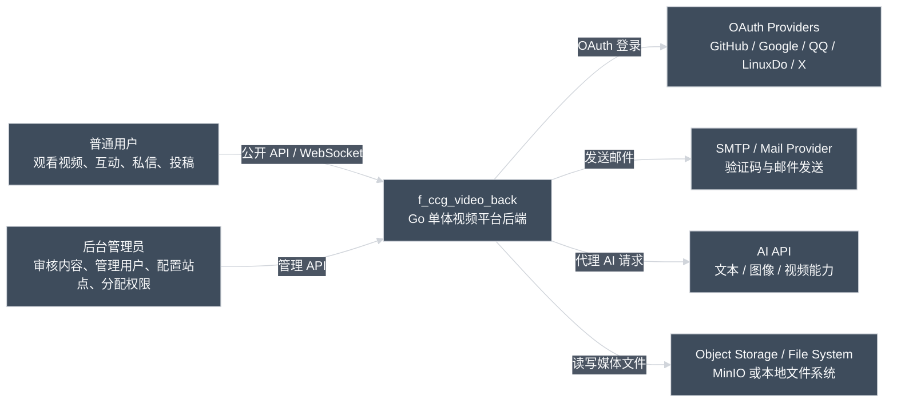

**这张图回答的问题**：

- 系统外部有哪些人和系统在与后端交互；
- 这个仓库不是“只管 HTTP”，它同时还承担了媒体处理与 AI 代理；
- MinIO / 本地文件系统虽然常被当作基础设施，但在系统上下文里对业务也很关键。

### 4.2 Container（容器图）

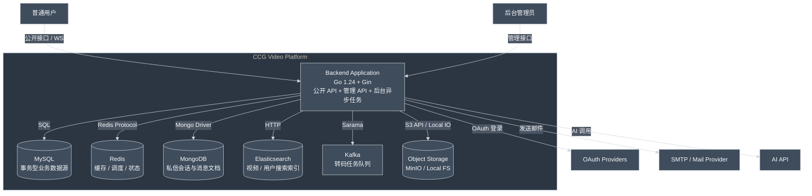

**容器层结论**：

- 这不是微服务拆分项目，而是**一个后端应用容器**连接多种存储与外部系统；
- 搜索、转码、调度这些能力没有独立服务化，而是和 HTTP API 共进程运行；
- 因此排查问题时要优先区分：**同步请求链路**、**后台子系统链路**、**外部基础设施链路**。

### 4.3 Component（组件图：同步请求主链路）

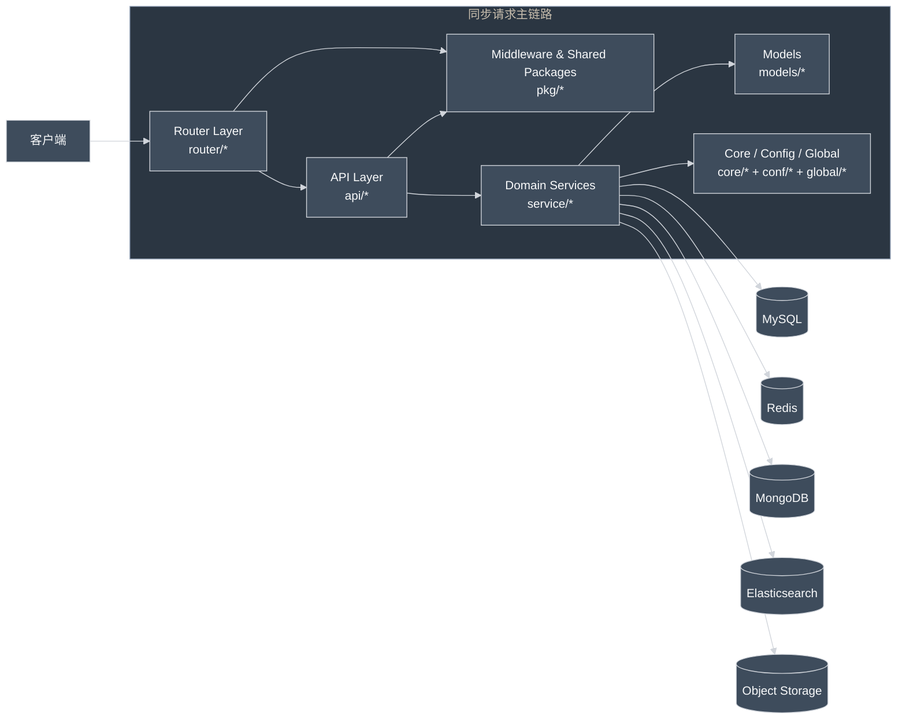

### 4.4 Component（组件图：后台与异步子系统）

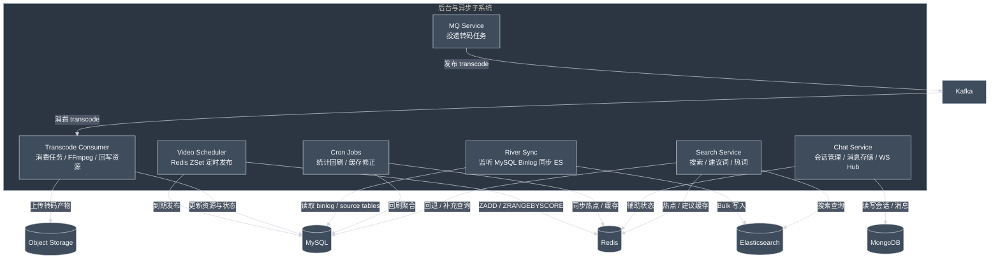

### 4.5 Deployment（部署视图）

> 仓库里的 `docker-compose.yaml` 主要声明的是**基础设施栈**，并没有把后端应用本身也放进去。  
> 所以下图采用“**应用进程宿主机 + Docker Compose Infra**”的表达，更贴近仓库现状。

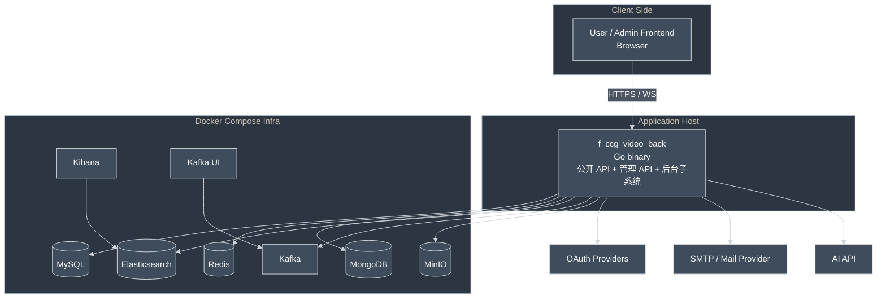

---

## 5. 启动与运行时装配

### 5.1 启动顺序图

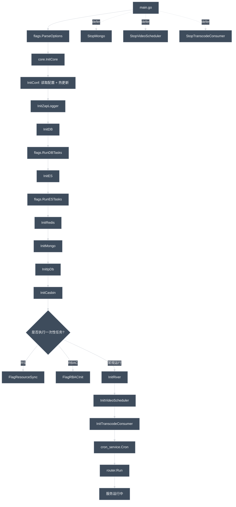

### 5.2 启动阶段解读

1. **配置最先初始化**：`InitConf()` 负责读取配置文件，并通过 Viper 监听配置热更新。
2. **MySQL / ES 的一次性任务前置**：数据库迁移、ES 索引初始化属于启动早期动作，便于以 CLI 方式单独执行。
3. **Redis / Mongo / Casbin 后再进入长期后台任务**：River、Video Scheduler、Transcode Consumer、Cron 都依赖前置基础设施。
4. **主进程退出时会显式关闭后台子系统**：这比只关 HTTP server 更接近“应用生命周期管理”。

---

## 6. 关键运行流程

### 6.1 视频上传、投稿与异步转码

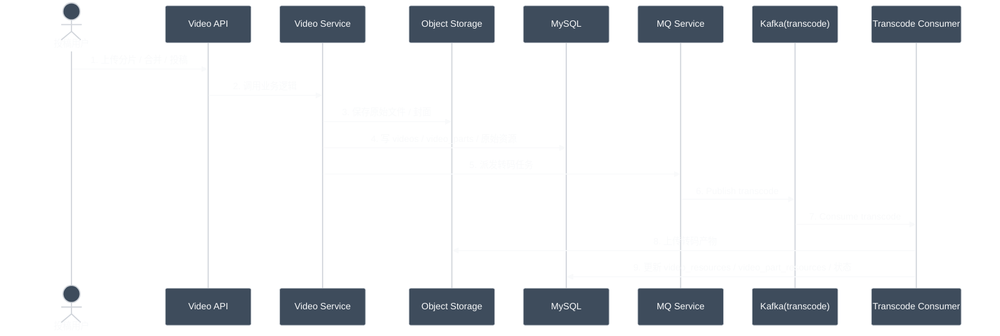

**这一条链路里最重要的边界**：

- “上传成功”不等于“已经可多清晰度播放”；
- `videos` / `video_parts` 是内容主数据，`video_resources` / `video_part_resources` 是媒体资源数据；
- 转码能力通过 Kafka 解耦，避免投稿接口直接阻塞在 FFmpeg 上。

### 6.2 MySQL Binlog -> River -> Elasticsearch

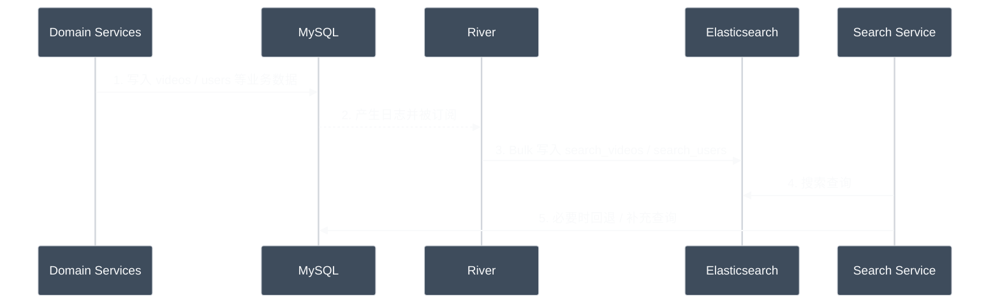

**当前配置层面的同步范围**：

- source tables：`videos`、`users`、`tags`、`video_tags`、`user_focus`
- direct indexed tables：`videos -> search_videos`、`users -> search_users`

也就是说：**MySQL 是真相源，ES 是投影索引，不是主存储**。

### 6.3 视频定时发布（Redis ZSet）

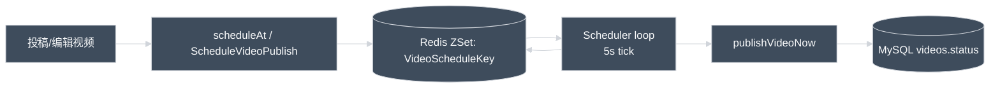

**说明**：

- 项目里的视频定时发布不是依赖 Cron 表，而是依赖 **Redis ZSet + 常驻扫描循环**；
- 到期后会把视频状态推进到已发布；
- 这条链路对 Redis 可用性敏感，所以遇到“定时发布失效”时应先检查 Redis 与调度器是否启动。

---

## 7. 存储职责分工

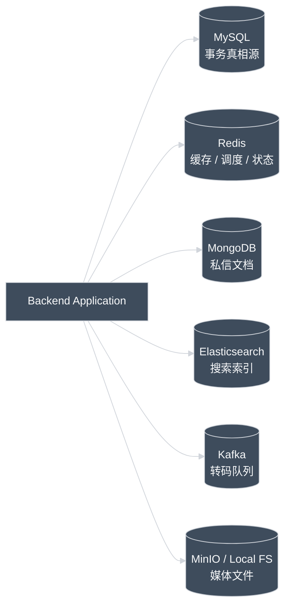

| 存储/中间件 | 在系统里的角色 | 主要承载数据 | 备注 |
| --- | --- | --- | --- |
| MySQL | 事务真相源 | 用户、视频、评论、弹幕、动态、通知、RBAC 等 | 通过 GORM 管理；迁移时关闭物理 FK 约束自动创建 |
| Redis | 高速缓存与短期状态 | 热门数据、定时发布任务、部分会话/状态 | 视频定时发布依赖 ZSet |
| MongoDB | 文档型聊天存储 | `chat_conversations`、`chat_messages` | 私信/聊天场景比关系表更适合文档建模 |
| Elasticsearch | 搜索投影索引 | `search_videos`、`search_users` | 由 River 增量同步，不是主数据源 |
| Kafka | 异步任务缓冲层 | `transcode` 转码任务 | 解耦投稿接口与转码处理 |
| MinIO / Local FS | 媒体文件存储 | 原视频、封面、转码产物 | 存储层通过 `service/storage_service` 抽象 |

---

## 8. 数据库架构（重点）

> **非常重要**：`core/init_db.go` 中开启了 `DisableForeignKeyConstraintWhenMigrating: true`。  
> 所以下面的图表达的是**代码/业务层面的逻辑关系**，不意味着数据库里一定真的建了物理外键。  
> 另外，`video_tags` 虽然不在 `FlagDB()` 的显式迁移列表里，但会因为 `many2many:video_tags` 关系而作为**隐式中间表**参与建模。

### 8.1 全表分域图（MySQL + MongoDB）

```mermaid
%%{init: {"theme":"base","themeVariables":{"background":"#2f343f","primaryColor":"#3e4c5c","primaryTextColor":"#F9FAFB","primaryBorderColor":"#D1D5DB","lineColor":"#D1D5DB","secondaryColor":"#4b5563","tertiaryColor":"#374151","clusterBkg":"#2b3642","clusterBorder":"#94A3B8","fontSize":"15px"}}}%%
flowchart LR
    subgraph MYSQL["MySQL 事务库"]
        subgraph ACCOUNT["账号与用户关系"]
            users
            user_confs
            user_ban_records
            user_login_records
            user_exp_records
            user_coin_records
            user_focus
        end

        subgraph RBAC["权限与后台"]
            roles
            menus
            user_roles
            role_menus
            api_resources
            casbin_rule
        end

        subgraph CONTENT["视频内容与媒体"]
            video_partitions
            banners
            videos
            video_parts
            video_resources
            video_part_resources
            tags
            video_tags
            favorite_folders
            favorite_folder_videos
            video_play_histories
            video_likes
            video_coins
        end

        subgraph INTERACT["互动 / 举报 / 通知"]
            dynamics
            dynamic_likes
            dynamic_reads
            comments
            comment_likes
            danmu
            danmu_likes
            video_reports
            danmu_reports
            user_global_notifications
        end
    end

    subgraph MONGO["MongoDB 文档库"]
        chat_conversations
        chat_messages
    end

    users --> user_confs
    users --> user_ban_records
    users --> user_login_records
    users --> user_exp_records
    users --> user_coin_records
    users --> user_focus

    users --> user_roles
    roles --> user_roles
    roles --> role_menus
    menus --> role_menus
    roles -. subject .-> casbin_rule
    api_resources -. resource .-> casbin_rule

    users --> videos
    video_partitions --> videos
    video_partitions --> banners
    videos --> video_parts
    videos --> video_resources
    video_parts --> video_part_resources
    videos --> video_tags
    tags --> video_tags
    users --> favorite_folders
    favorite_folders --> favorite_folder_videos
    videos --> favorite_folder_videos
    users --> video_play_histories
    videos --> video_play_histories
    users --> video_likes
    videos --> video_likes
    users --> video_coins
    videos --> video_coins

    users --> dynamics
    dynamics --> dynamic_likes
    users --> dynamic_likes
    users --> dynamic_reads
    users --> comments
    videos --> comments
    dynamics --> comments
    comments --> comment_likes
    users --> comment_likes
    users --> danmu
    videos --> danmu
    video_parts --> danmu
    danmu --> danmu_likes
    users --> danmu_likes
    videos --> video_reports
    danmu --> danmu_reports
    users -. operator .-> video_reports
    users -. operator .-> danmu_reports
    users -. receiver/action .-> user_global_notifications
    videos -. related .-> user_global_notifications
    dynamics -. related .-> user_global_notifications
    comments -. related .-> user_global_notifications

    chat_conversations --> chat_messages
```

### 8.2 账号、关系与 RBAC（关系总览 + 字段清单）

> 说明：图里只保留关系，不再把大量字段塞进 Mermaid 盒子里；字段请直接看图下方表格，这样在你的深色主题预览里会清楚很多。

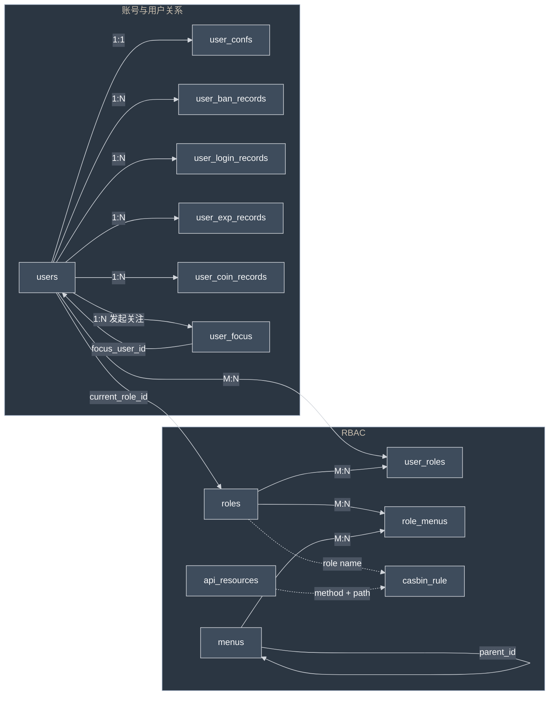

#### 8.2 字段清单（可读版）

| 表 | 字段 |
| --- | --- |
| `users` | `avatar, birthday, coin_count, created_at, current_role_id, description, email, exp, gender, id, last_login_addr, last_login_ip, level, open_id, password, register_addr, register_ip, register_source, status, updated_at, username` |
| `user_confs` | `banner_id, banner_url, like_tags, open_coin_video, open_collect, open_fans, open_follow, open_like_video, user_id` |
| `user_ban_records` | `created_at, days, end_at, id, operator_id, reason, start_at, status, updated_at, user_id` |
| `user_login_records` | `addr, created_at, id, ip, login_type, updated_at, user_agent, user_id` |
| `user_exp_records` | `created_at, dedup_key, delta, id, reason, updated_at, user_id` |
| `user_coin_records` | `created_at, dedup_key, delta, id, reason, updated_at, user_id` |
| `user_focus` | `created_at, focus_user_id, id, updated_at, user_id` |
| `roles` | `created_at, desc, id, name, updated_at` |
| `user_roles` | `role_id, user_id` |
| `menus` | `component, created_at, icon, id, keep_alive, name, parent_id, path, sort_order, title, title_en, title_ja, updated_at` |
| `role_menus` | `is_inherited, menu_id, role_id` |
| `api_resources` | `created_at, id, method, path, summary, tags, updated_at` |
| `casbin_rule` | `id, ptype, v0, v1, v2, v3, v4, v5` |

### 8.3 视频内容、媒体与收藏（关系总览 + 字段清单）

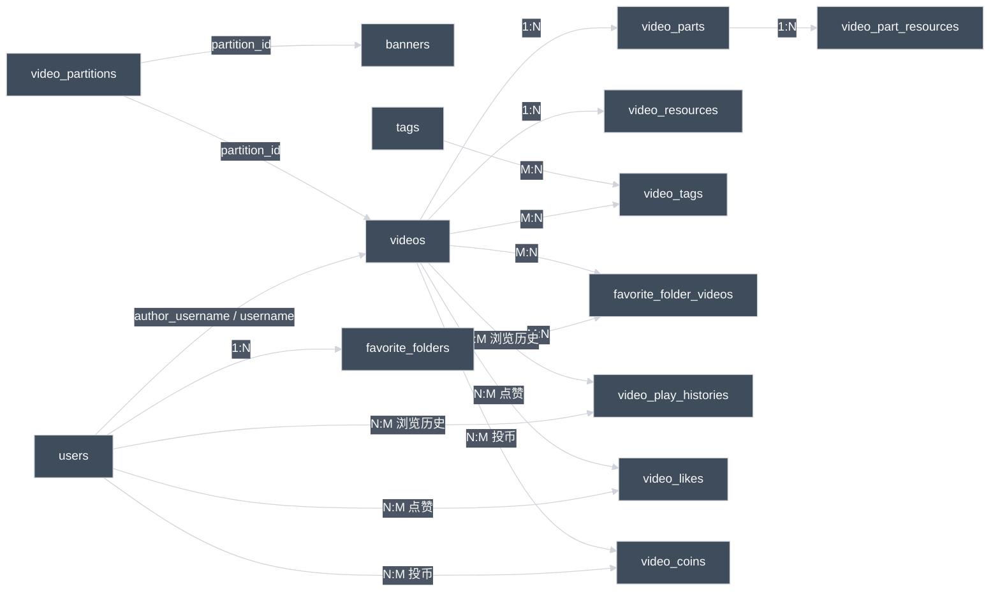

#### 8.3 字段清单（可读版）

| 表 | 字段 |
| --- | --- |
| `video_partitions` | `created_at, icon, id, is_active, is_submittable, name, sort_order, updated_at` |
| `banners` | `cover, created_at, href, id, partition_id, show, type, updated_at` |
| `videos` | `author_username, coin_count, comment_count, cover, created_at, danmu_count, description, duration, favorite_count, id, is_original, is_pinned, likes, partition_id, pinned_at, status, storage_type, title, updated_at, views` |
| `video_parts` | `created_at, danmu_count, duration, id, sort_order, storage_type, title, updated_at, video_id` |
| `video_resources` | `bitrate, codec, created_at, file_size, file_url, format, id, is_souce_video, is_vip, resolution, source_file_name, updated_at, video_id` |
| `video_part_resources` | `bitrate, codec, created_at, file_size, file_url, format, id, is_souce_video, is_vip, resolution, source_file_name, updated_at, video_part_id` |
| `tags` | `created_at, id, name, updated_at` |
| `video_tags` | `tag_id, video_id` |
| `favorite_folders` | `created_at, id, is_default, name, updated_at, user_id` |
| `favorite_folder_videos` | `created_at, favorite_folder_id, video_id` |
| `video_play_histories` | `created_at, duration, progress, user_id, video_id` |
| `video_likes` | `created_at, id, updated_at, user_id, video_id` |
| `video_coins` | `coins, created_at, id, updated_at, user_id, video_id` |
| `users` | `见 8.2 字段清单（本域主要通过 author_username / username 与视频关联）` |

### 8.4 评论、弹幕、动态、举报与通知（关系总览 + 字段清单）

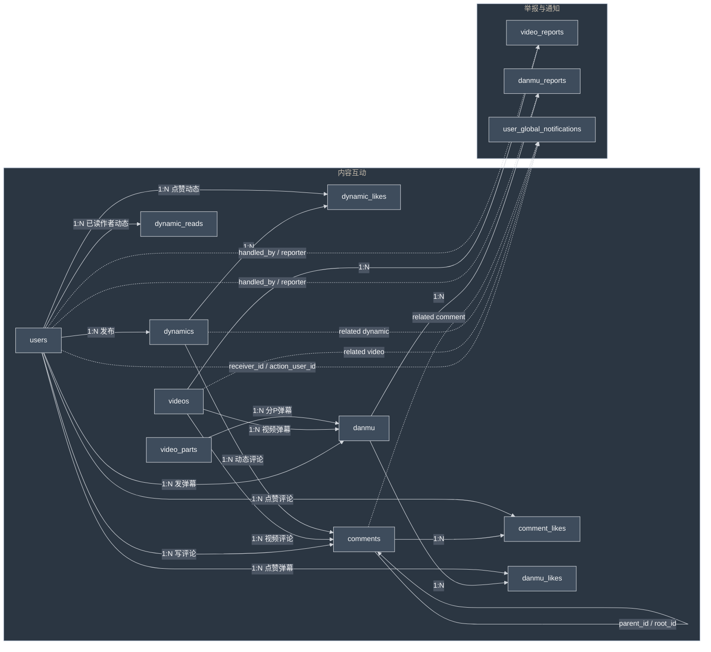

#### 8.4 字段清单（可读版）

| 表 | 字段 |
| --- | --- |
| `dynamics` | `content, created_at, id, image_url, is_pinned, like_count, pinned_at, updated_at, user_id` |
| `dynamic_likes` | `created_at, dynamic_id, id, updated_at, user_id` |
| `dynamic_reads` | `author_id, created_at, id, last_read_work_at, last_read_work_id, last_read_work_type, updated_at, user_id` |
| `comments` | `at_user_ids, comment_type, commenter_addr, commenter_ip, content, created_at, dynamic_id, id, is_pinned, like_count, parent_id, pictures, pinned_at, reply_count, root_id, updated_at, user_id, video_id` |
| `comment_likes` | `comment_id, created_at, id, updated_at, user_id` |
| `danmu` | `color, content, created_at, font_size, id, like_count, position, time_offset, updated_at, user_id, video_id, video_part_id` |
| `danmu_likes` | `created_at, danmu_id, id, updated_at, user_id` |
| `video_reports` | `created_at, detail, handle_note, handled_at, handled_by, id, image_urls, reason, reporter_username, status, updated_at, video_id` |
| `danmu_reports` | `created_at, danmu_id, detail, handle_note, handled_at, handled_by, id, reason, reporter_username, status, updated_at, video_id` |
| `user_global_notifications` | `action_user_avatar, action_user_id, action_user_name, comment_id, content, created_at, dynamic_id, id, is_read, link, receiver_id, title, type, updated_at, video_id, video_title` |
| `users` | `见 8.2 字段清单` |
| `videos` | `见 8.3 字段清单` |
| `video_parts` | `见 8.3 字段清单` |

### 8.5 MongoDB：私信文档模型（关系总览 + 字段清单）

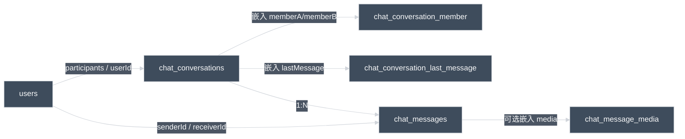

#### 8.5 字段清单（可读版）

| 集合 / 嵌入文档 | 字段 |
| --- | --- |
| `chat_conversations` | `_id, participants, memberA, memberB, lastMessage, createdAt, updatedAt` |
| `chat_conversation.memberA / memberB` | `userId, unread, visible, lastReadAt, lastReadMsgId` |
| `chat_conversation.lastMessage` | `msgId, type, preview, senderId, createdAt` |
| `chat_messages` | `_id, conversationId, senderId, receiverId, type, text, emoji, media, createdAt` |
| `chat_message.media` | `url, mime, width, height, size` |
| `users` | `见 8.2 字段清单` |

### 8.6 关系建模注意事项

1. `videos.author_username -> users.username` 是一个**非 `user_id` 型**关联，排查数据对不齐时要特别注意。
2. `user_global_notifications.receiver_id` 里 `-1` 表示“全员广播”，所以它不是严格的普通外键。
3. `casbin_rule` 与 `roles` / `api_resources` 的关系主要是**策略语义映射**：
   - `v0` 常映射角色名；
   - `v1 + v2` 常映射请求方法 + 路径。
4. `video_tags` 是 GORM `many2many` 关系生成的中间表，但在理解视频标签链路时必须把它当成真实表看待。
5. Mongo 的 `chat_conversations` / `chat_messages` 不是“拍脑袋并行库”，而是为了适配私信场景中的：
   - 会话快照；
   - 最近消息嵌入；
   - 媒体消息文档结构；
   - 可扩展的 WebSocket 会话态。

### 8.7 MySQL 全表字段清单（完整覆盖）

展开查看 MySQL 全表字段清单（36 张表 / 中间表，含隐式 <code>video_tags</code>）

| 表名 | 字段 |
| --- | --- |
| `api_resources` | `created_at, id, method, path, summary, tags, updated_at` |
| `banners` | `cover, created_at, href, id, partition_id, show, type, updated_at` |
| `casbin_rule` | `id, ptype, v0, v1, v2, v3, v4, v5` |
| `comment_likes` | `comment_id, created_at, id, updated_at, user_id` |
| `comments` | `at_user_ids, comment_type, commenter_addr, commenter_ip, content, created_at, dynamic_id, id, is_pinned, like_count, parent_id, pictures, pinned_at, reply_count, root_id, updated_at, user_id, video_id` |
| `danmu` | `color, content, created_at, font_size, id, like_count, position, time_offset, updated_at, user_id, video_id, video_part_id` |
| `danmu_likes` | `created_at, danmu_id, id, updated_at, user_id` |
| `danmu_reports` | `created_at, danmu_id, detail, handle_note, handled_at, handled_by, id, reason, reporter_username, status, updated_at, video_id` |
| `dynamic_likes` | `created_at, dynamic_id, id, updated_at, user_id` |
| `dynamic_reads` | `author_id, created_at, id, last_read_work_at, last_read_work_id, last_read_work_type, updated_at, user_id` |
| `dynamics` | `content, created_at, id, image_url, is_pinned, like_count, pinned_at, updated_at, user_id` |
| `favorite_folder_videos` | `created_at, favorite_folder_id, video_id` |
| `favorite_folders` | `created_at, id, is_default, name, updated_at, user_id` |
| `menus` | `component, created_at, icon, id, keep_alive, name, parent_id, path, sort_order, title, title_en, title_ja, updated_at` |
| `role_menus` | `is_inherited, menu_id, role_id` |
| `roles` | `created_at, desc, id, name, updated_at` |
| `tags` | `created_at, id, name, updated_at` |
| `user_ban_records` | `created_at, days, end_at, id, operator_id, reason, start_at, status, updated_at, user_id` |
| `user_coin_records` | `created_at, dedup_key, delta, id, reason, updated_at, user_id` |
| `user_confs` | `banner_id, banner_url, like_tags, open_coin_video, open_collect, open_fans, open_follow, open_like_video, user_id` |
| `user_exp_records` | `created_at, dedup_key, delta, id, reason, updated_at, user_id` |
| `user_focus` | `created_at, focus_user_id, id, updated_at, user_id` |
| `user_global_notifications` | `action_user_avatar, action_user_id, action_user_name, comment_id, content, created_at, dynamic_id, id, is_read, link, receiver_id, title, type, updated_at, video_id, video_title` |
| `user_login_records` | `addr, created_at, id, ip, login_type, updated_at, user_agent, user_id` |
| `user_roles` | `role_id, user_id` |
| `users` | `avatar, birthday, coin_count, created_at, current_role_id, description, email, exp, gender, id, last_login_addr, last_login_ip, level, open_id, password, register_addr, register_ip, register_source, status, updated_at, username` |
| `video_coins` | `coins, created_at, id, updated_at, user_id, video_id` |
| `video_likes` | `created_at, id, updated_at, user_id, video_id` |
| `video_part_resources` | `bitrate, codec, created_at, file_size, file_url, format, id, is_souce_video, is_vip, resolution, source_file_name, updated_at, video_part_id` |
| `video_partitions` | `created_at, icon, id, is_active, is_submittable, name, sort_order, updated_at` |
| `video_parts` | `created_at, danmu_count, duration, id, sort_order, storage_type, title, updated_at, video_id` |
| `video_play_histories` | `created_at, duration, progress, user_id, video_id` |
| `video_reports` | `created_at, detail, handle_note, handled_at, handled_by, id, image_urls, reason, reporter_username, status, updated_at, video_id` |
| `video_resources` | `bitrate, codec, created_at, file_size, file_url, format, id, is_souce_video, is_vip, resolution, source_file_name, updated_at, video_id` |
| `video_tags` | `tag_id, video_id` |
| `videos` | `author_username, coin_count, comment_count, cover, created_at, danmu_count, description, duration, favorite_count, id, is_original, is_pinned, likes, partition_id, pinned_at, status, storage_type, title, updated_at, views` |

### 8.8 Mongo 集合字段清单

| 集合/嵌入文档 | 字段 |
| --- | --- |
| `chat_conversations` | `_id, participants, memberA, memberB, lastMessage, createdAt, updatedAt` |
| `chat_conversation.memberA/memberB` | `userId, unread, visible, lastReadAt, lastReadMsgId` |
| `chat_conversation.lastMessage` | `msgId, type, preview, senderId, createdAt` |
| `chat_messages` | `_id, conversationId, senderId, receiverId, type, text, emoji, media, createdAt` |
| `chat_message.media` | `url, mime, width, height, size` |

---

## 9. 目录与分层对应关系

| 目录 | 在架构中的位置 | 说明 |
| --- | --- | --- |
| `main.go` | 进程入口 | 解析启动参数、初始化核心能力、启动 Gin、注册退出清理 |
| `flags/` | 启动/运维入口 | 数据库迁移、ES 初始化、RBAC 初始化、资源同步 |
| `core/` | 基础设施装配层 | 初始化配置、日志、DB、Redis、Mongo、ES、Casbin、River、Consumer |
| `router/` | HTTP 入口层 | 路由分组、公共中间件、公开/管理接口装配 |
| `api/` | Handler 层 | 参数绑定、鉴权、调用 service、统一响应 |
| `service/` | 业务服务层 | 核心业务规则、异步任务、搜索、聊天、转码、调度 |
| `models/` | 数据模型层 | MySQL 实体、Mongo 文档、枚举 |
| `pkg/` | 横切公共层 | middleware、response、JWT、上下文工具、常量、工具函数 |
| `conf/` | 配置结构定义 | 统一承接 Viper 配置反序列化 |
| `docs/` | 文档层 | OpenAPI、项目架构、专题文档 |
| `docker-compose.yaml` | 基础设施样例 | MySQL、Redis、MongoDB、ES、Kafka、MinIO 等依赖编排 |

---

## 10. 最后用三句话总结这个项目

1. **它是单体，不是微服务**：同步请求、后台任务、搜索同步、转码消费者都跑在同一个 Go 应用边界内。
2. **它是视频业务驱动的多存储系统**：MySQL 保事务真相，Mongo 承载私信文档，Redis 提供缓存与调度，ES 提供搜索投影，Kafka 负责转码解耦，MinIO/本地盘负责媒体文件。
3. **理解它的最好方式不是从某个接口看起，而是从“C4 图 + 关键流程 + 数据库全表”三件事一起看。**

---

## 11. 关键实现锚点

- `main.go`
- `core/enter.go`
- `core/init_conf.go`
- `core/init_db.go`
- `router/enter.go`
- `flags/flag_db.go`
- `service/video_service/scheduler_service.go`
- `service/mq_service/enter.go`
- `service/chat_service/chat_service.go`
- `config_dev.yaml`
- `docker-compose.yaml`
