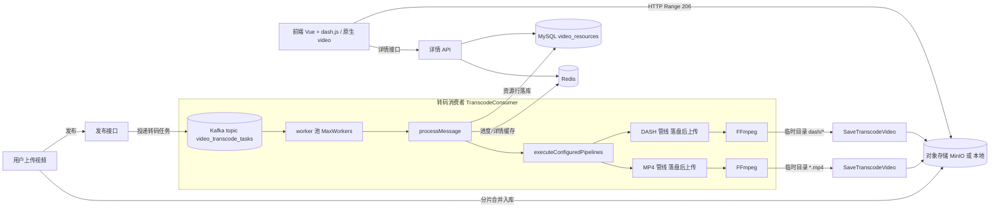
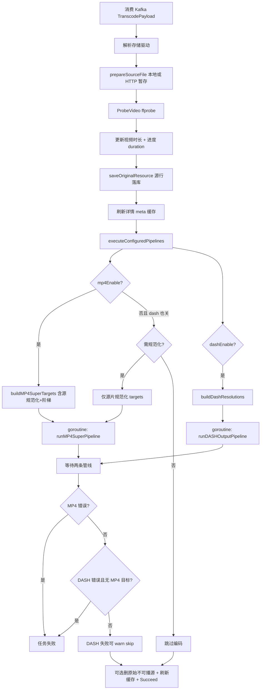
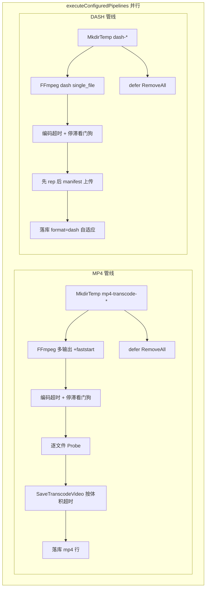
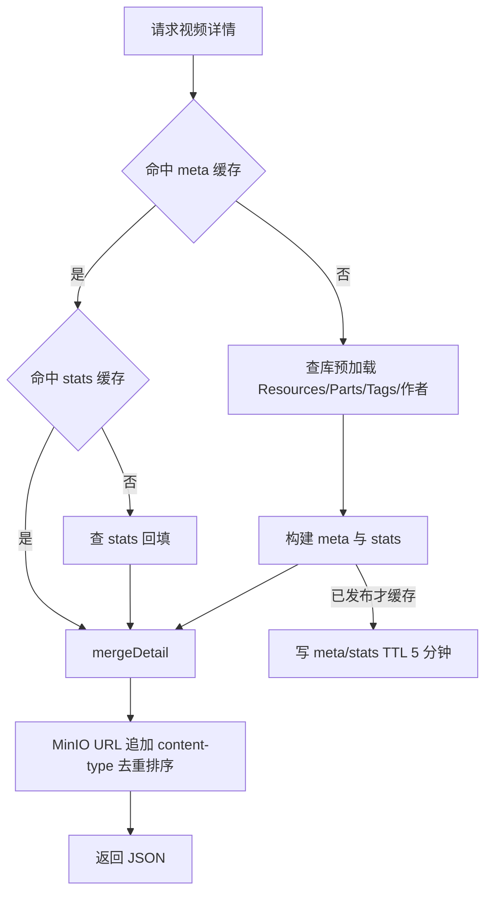
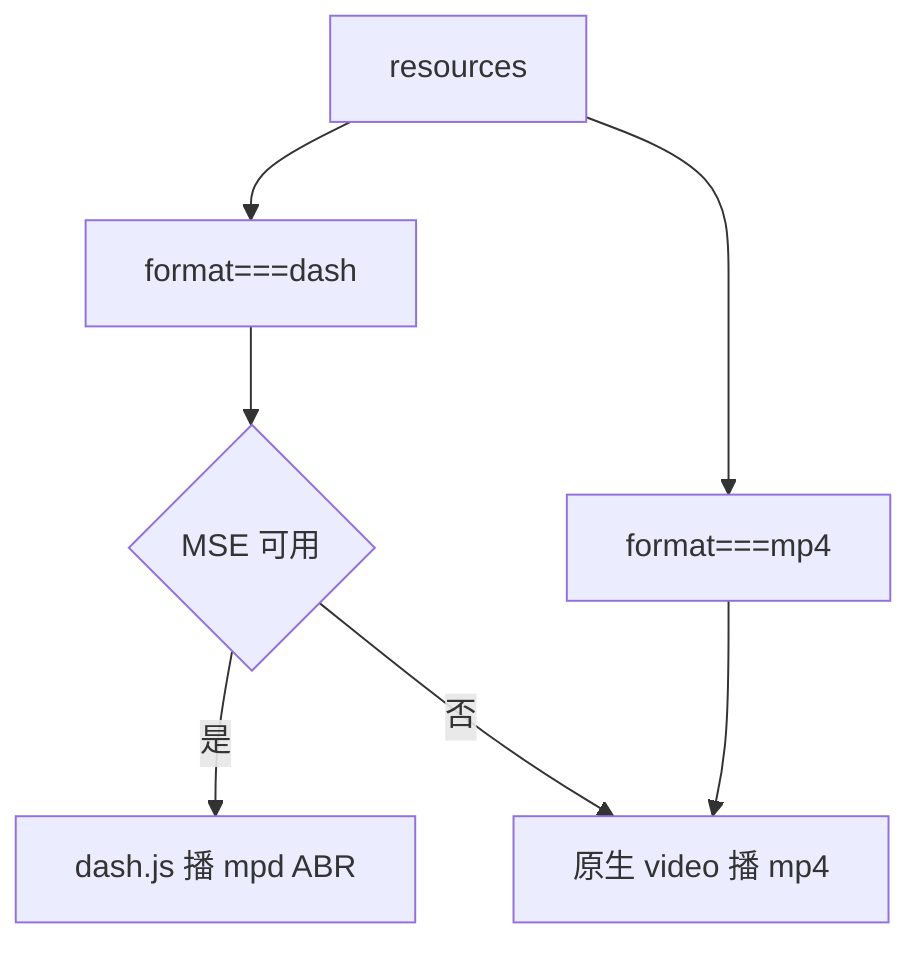

# 视频转码 · DASH 自适应 · 流式播放 架构说明

> **重构提示**：本文档从重构前的 `f_ccg_video_back` 继承，所述**设计与行为在本仓库 1:1 保留**，
> 但文中的**代码路径引用指向重构前的目录布局**。请配合
> [legacy-path-mapping.md](./legacy-path-mapping.md) 换算到新的 DDD 分层位置。


> 覆盖：**后端转码流程**、**超时与看门狗**、**断点续传**、**详情接口返回**、**前端如何流式播放**。  
> 混合模式：每分辨率 **MP4 直链** 与一套 **DASH 自适应流**（`.mpd` + 各码率 mp4）可并存。

---

## 1. 全局架构总览



要点：

- 转码**异步**：发布写 Kafka，消费者后台处理；前端只读详情拿产物 URL。
- **MP4 与 DASH 默认并行**（`executeConfiguredPipelines` 两个 goroutine），失败语义不同：MP4 硬失败；DASH 在已有 MP4 目标时失败可 skip。
- **两类产物均先写本地临时目录，再上传**（禁止「多路 TCP 边转边传」——历史上会因 multipart 背压把整棵 FFmpeg filter 图顶死）。
- 管理端进度：Redis + SSE（`out_time` 驱动）；僵死时靠停滞看门狗取消，而不是永远「处理中」。

---

## 2. 转码流程（processMessage → 并行管线）

入口：

- [service/mq_service/transcode_consumer.go](../service/mq_service/transcode_consumer.go) — `processMessage` / `runFFmpegPipeline` / `runDASHPipeline`
- [service/mq_service/transcode_pipeline_coordinator.go](../service/mq_service/transcode_pipeline_coordinator.go) — `executeConfiguredPipelines`
- [service/mq_service/transcode_timeout.go](../service/mq_service/transcode_timeout.go) — 超时与停滞看门狗
- [service/mq_service/transcode_progress.go](../service/mq_service/transcode_progress.go) — Redis 进度



### 阶段说明

| 阶段 | 做什么 | 关键入口 |
|---|---|---|
| 解析/校验 | Kafka → `TranscodePayload` | `processMessage` |
| 准备源 | 远程 URL 可 stage 到本地临时文件 | `prepareSourceFile` |
| 探测 | 宽高、码率、容器、编解码、音轨 | `ProbeVideo` |
| 源行落库 | 先挂「源视频」资源并刷缓存，避免发布后空占位 | `saveOriginalResource` |
| **并行管线** | 按配置启动 MP4 / DASH（可同时） | `executeConfiguredPipelines` |
| MP4 | 多输出写临时目录 → probe → 上传 → 落库 | `runMP4SuperPipeline` → `runFFmpegPipeline` |
| DASH | 临时目录 SegmentBase → 上传 → 落一行自适应 | `runDASHOutputPipeline` → `runDASHPipeline` |
| 清理 | 规范化成功后可删原始不可播源 | `DeleteStoredFile` |

> **源片规范化**：不再是独立「先转完再开阶梯」的串行 step4；当源不可播或高码率时，规范化目标合进 **MP4 Super Targets**（与 360/720/1080… 同一次 FFmpeg 多输出）。  
> **GPU/CPU**：`GpuMode`+`CpuMode` 都开 → 先 GPU，失败冷却后回退 CPU；只开一个则用开启的那个。两者不能同时 false。

### 配置开关（`transcode:`）

| 配置 | 作用 |
|---|---|
| `mp4Enable` | 是否产出多分辨率 MP4（含可选源规范化目标） |
| `dashEnable` | 是否产出 DASH |
| 两者都 false | 仍可能只做**源片规范化**；源已可播且非高码率则跳过重编码 |
| `transcodeResolutions` | 阶梯高度列表（MP4/DASH 共用，clamp 到源高以内） |
| `maxWorkers` | 消费者并发任务数 |
| `threads` / `cpuPreset` / `gpu*` / `crf*` | 编码质量与线程 |

---

## 3. MP4 / DASH 两条管道（当前实现）

### 3.1 为何都要落盘

旧实现：MP4 多路输出写本地 TCP，Go `Accept` 后 `PutObject(size=-1)` 边转边 multipart 上传。

问题：

1. 一个 FFmpeg 多输出要求各路**同步排水**。
2. 任一路上传变慢/卡住 → TCP 窗口满 → **整棵 filter 图停转**（CPU≈0，进度永久停住，无成品）。
3. DASH 本来就写临时目录，因此能在 MP4 僵死后仍单独跑完。

当前：**MP4 与 DASH 同构** — 先本地文件，再上传。编码与对象存储 I/O 解耦。



| 项 | MP4 | DASH |
|---|---|---|
| 临时目录 | `mp4-transcode-*` | `dash-*` |
| FFmpeg 输出 | 多路文件 `-movflags +faststart` | `-f dash -single_file 1` |
| 上传 | 编码成功后**串行**逐文件（降低 MinIO 压力） | 先各 stream 再 `manifest.mpd` |
| 失败语义 | 任务失败 | 若已有 MP4 目标则 warn skip；仅 DASH 时失败则任务失败 |
| 对象路径 | `.../<hash>_<h>p.mp4` 等 | `.../dash/manifest.mpd` + `...-streamN.mp4` |

### 3.2 DASH 单文件 SegmentBase

```
ffmpeg -i <src>
  -filter_complex "[0:v]split=N...; scale..."
  -map [out0] -c:v:0 libx264 -crf:v:0 <q> -maxrate:v:0 <k>k ...
  -map 0:a:0 -c:a aac -b:a 128k          # 有音轨时
  -f dash -single_file 1
  -single_file_name <FileHash>-stream$RepresentationID$.mp4
  -dash_segment_type mp4 -seg_duration 4
  -adaptation_sets "id=0,streams=v id=1,streams=a"
  <tmp>/manifest.mpd
```

产物：

```
videos/<...>/dash/
  ├─ manifest.mpd
  ├─ <hash>-stream0.mp4
  ├─ <hash>-stream1.mp4
  └─ ...
```

> **相对 BaseURL**：mpd 用相对文件名引用 rep；mpd 与 rep 必须同前缀目录。**前端不可改写 mpd URL/查询串**，否则 404。

### 3.3 码率封顶（`-maxrate`）摘要

- 统一 **CRF/CQP 质量模式 + `-maxrate` 上限**（capped CRF/CQP）。
- 标准档：`calcOutputBitrateForRes` 按分辨率 reduce，带保底；**若源码率 ≤ 该档保底，直接用源码率、不 reduce**（不会把 maxrate 抬过源）。
- High 档：按 High reduce 比例；`MaxrateUseSource` 时 maxrate=源码率。

---

## 4. 超时、停滞看门狗与常量说明

实现文件：[service/mq_service/transcode_timeout.go](../service/mq_service/transcode_timeout.go)。

**重要：下列常量不是限速，也不限制实际上传带宽。**  
它们只用于**估算墙钟超时 / 判定僵死**，让任务在卡死时失败可重试，而不是永远占着 worker。

### 4.1 三类超时如何协作

```text
┌──────────────────────────────────────────────────────────┐
│ FFmpeg 编码（写本地临时文件）                              │
│  · encodeTimeout* + 时长/路数/体积公式                     │
│    → 整次编码「最多允许跑多久」                            │
│  · progressStall*                                         │
│    → out_time 多久不前进就当死锁杀掉（通常比总超时更早）    │
└──────────────────────────────────────────────────────────┘
                          ↓ 编码成功
┌──────────────────────────────────────────────────────────┐
│ 逐文件上传对象存储                                         │
│  · defaultUploadMinBytesPerSec + uploadTimeout*           │
│    → 按文件字节数估算「这次上传最久等多久」                │
└──────────────────────────────────────────────────────────┘
```

| 场景 | 主要靠谁 |
|---|---|
| 4K CPU 多路，正常但很慢 | 编码总超时偏宽裕，一般不误杀 |
| 进程还在、CPU≈0、进度不动 | **进度停滞**（约 5～20 分钟） |
| 编码完了，PutObject 挂住 | **上传超时**（按体积，3 分钟～2 小时） |
| ffprobe 时长为 0 / 失败 | **`defaultDurationSec`** 代入编码与停滞公式 |

哨兵错误（可 `errors.Is`）：

- `ErrTranscodeProgressStalled`
- `ErrTranscodeEncodeTimeout`
- `ErrTranscodeUploadTimeout`

### 4.2 常量一览

```go
const (
    defaultUploadMinBytesPerSec int64 = 512 * 1024 // 512 KiB/s
    uploadTimeoutBase                   = 2 * time.Minute
    uploadTimeoutMin                    = 3 * time.Minute
    uploadTimeoutMax                    = 2 * time.Hour

    encodeTimeoutMin = 15 * time.Minute
    encodeTimeoutMax = 12 * time.Hour

    progressStallMin = 5 * time.Minute
    progressStallMax = 20 * time.Minute

    defaultDurationSec = 600 // 10 分钟
)
```

---

### 4.3 上传相关常量

#### `defaultUploadMinBytesPerSec = 512 * 1024`（512 KiB/s）

| 项 | 说明 |
|---|---|
| **是什么** | 估算上传超时时假定的「最差可接受吞吐」 |
| **不是什么** | **不是**实际上传限速；`PutObject` 能跑多快就多快 |
| **怎么用** | `预计秒数 ≈ fileSize / 512KiB/s`，再加 `uploadTimeoutBase` |
| **为何 512KiB/s** | 相对本地/局域网 MinIO 偏保守 → 超时更宽，少误杀；真卡死仍会在上限内失败 |
| **调大**（如 2MiB/s） | 同样体积超时更短，卡死暴露更快，忙时更易误超时 |
| **调小**（如 128KiB/s） | 超时更宽，大文件更不容易误杀，僵死要等更久 |

#### `uploadTimeoutBase = 2 * time.Minute`

| 项 | 说明 |
|---|---|
| **是什么** | 与文件大小无关的固定开销 |
| **覆盖** | 建连、鉴权、开 multipart、complete、偶发抖动 |
| **为何单独加** | 小文件按吞吐可能只算出几秒，但握手本身往往更久；没有 base 容易误超时 |

#### `uploadTimeoutMin = 3 * time.Minute`

| 项 | 说明 |
|---|---|
| **是什么** | 单文件上传超时的**下限** |
| **例子** | 10MB 按公式可能 < 3 分钟 → 强制至少 3 分钟 |
| **目的** | 小文件也留足 GC/磁盘尖峰余量 |

#### `uploadTimeoutMax = 2 * time.Hour`

| 项 | 说明 |
|---|---|
| **是什么** | 单文件上传超时的**上限** |
| **例子** | 数 GB 按 512KiB/s 可能算到很多小时 → 钳在 2 小时 |
| **目的** | 防止「永远上传中」占死 worker |

**上传公式（`calcUploadTimeout`）：**

```text
若 fileSize <= 0:
    返回 30 分钟（兜底；落盘路径正常有 size）

否则:
    secs = ceil(fileSize / defaultUploadMinBytesPerSec)
    d    = secs + uploadTimeoutBase
    返回 clamp(d, uploadTimeoutMin, uploadTimeoutMax)
```

---

### 4.4 编码总超时常量

用于 `calcPipelineEncodeTimeout(durationSec, targetCount, useGPU, sourceBytes)`，挂在 **MP4 / DASH 各自** 的 FFmpeg `CommandContext` 上。

#### `encodeTimeoutMin = 15 * time.Minute`

| 项 | 说明 |
|---|---|
| **是什么** | 整次 FFmpeg 编码墙钟预算的**最短时间** |
| **例子** | 30 秒短视频按倍率算出 10 分钟 → 抬到 15 分钟 |
| **目的** | 覆盖冷启动、滤镜初始化、GPU 失败回退等固定成本 |

#### `encodeTimeoutMax = 12 * time.Hour`

| 项 | 说明 |
|---|---|
| **是什么** | 编码墙钟预算的**最长天花板** |
| **目的** | 防止异常慢编码占满机器；正常长 4K CPU 多路通常远小于 12 小时 |
| **注意** | 真死锁应靠 **进度停滞** 更早杀掉，不必干等到 12 小时 |

**编码公式（概念）：**

```text
时长 = durationSec > 0 ? durationSec : defaultDurationSec
倍率 = useGPU ? 6 : 20
若 targetCount > 2:
    倍率 += (targetCount - 2) * 2

预算 = 时长秒 * 倍率
若 sourceBytes > 0:
    预算 += floor(sourceBytes / 50MiB) * 1 分钟   // 体积加成

返回 clamp(预算, encodeTimeoutMin, encodeTimeoutMax)
```

- **主依据是片长**，不是单纯「每 MB 多少编码时间」。  
- **源文件体积**只做加成（约每 50MiB +1 分钟），让重 4K 源更宽裕。  
- CPU 倍率（20）远大于 GPU（6），因为多输出 libx264 可能远慢于实时。

---

### 4.5 进度停滞常量

用于 `calcProgressStallTimeout` + `withProgressStallGuard`：包装 FFmpeg `-progress` 的 `out_time`；超过静默上限则 `CancelCause(ErrTranscodeProgressStalled)` 并杀掉进程。

#### `progressStallMin = 5 * time.Minute`

| 项 | 说明 |
|---|---|
| **是什么** | 判定「进度停滞」前至少要静默这么久 |
| **例子** | 1 分钟短片按时长/6 只有约 10 秒 → 抬到 5 分钟 |
| **目的** | 容忍短暂无 out_time（seek、尖峰），避免误杀 |

#### `progressStallMax = 20 * time.Minute`

| 项 | 说明 |
|---|---|
| **是什么** | 停滞判定的**上限** |
| **例子** | 2 小时片源 时长/6=20 分钟 → 最多等 20 分钟无进度就杀 |
| **目的** | 长任务也不会在「僵尸状态」挂数小时 |

**停滞公式：**

```text
stall = clamp(片长秒 / 6, progressStallMin, progressStallMax)
```

例：23 分钟片 → 1380/6 ≈ 3.8 分钟 → 低于下限 → **5 分钟**无 `out_time` 取消。

轮询间隔：约 `stallLimit/3`，夹在 50ms～15s（生产多为数十秒一跳）。

---

### 4.6 时长兜底

#### `defaultDurationSec = 600`（10 分钟）

| 项 | 说明 |
|---|---|
| **是什么** | probe 时长 ≤0 时的假想片长 |
| **用于** | 编码总超时、进度停滞两套公式 |
| **为何 10 分钟** | 时长未知时不能当 0（预算塌掉），也不能当 2 小时（预算过大）；取常见短中视频附近的保守默认 |

---

### 4.7 设计原则（调参时对照）

| 原则 | 对应常量 |
|---|---|
| Min：短任务别误杀 | `encodeTimeoutMin` / `uploadTimeoutMin` / `progressStallMin` |
| Max：异常别占死 worker | `encodeTimeoutMax` / `uploadTimeoutMax` / `progressStallMax` |
| 上传按体积估 | `defaultUploadMinBytesPerSec` + `uploadTimeoutBase` |
| 编码按片长估 + 体积加成 | 公式 + `encodeTimeout*` + `defaultDurationSec` |
| 僵死靠停滞，不靠死等总超时 | `progressStall*` |

当前这些值为代码内常量；若需环境可调，可后续挂到 `conf.Transcode` / `config_*.yaml`。

---

## 5. 断点续传（重试不重复编码）

实现文件：[service/mq_service/transcode_checkpoint.go](../service/mq_service/transcode_checkpoint.go)、[service/mq_service/transcode_chunked.go](../service/mq_service/transcode_chunked.go)。

Kafka 重投递 / 进程内重试（最多 3 次）过去会**整单全量重编码**。现在任务被拆成可独立确认完成的单元（长视频的每个编码块、每个 MP4 target、一整套 DASH、远程源暂存文件、共享音轨），重试时逐单元跳过：

| 层级 | 状态依据 | 重试时的行为 |
|---|---|---|
| **L1 已入库** | MySQL 资源行 `file_url` 与本任务期望产物路径匹配 + 远端对象 `StatStoredFile` 有效 | 编码、上传、落库全部跳过 |
| **L2 本地已编码** | 断点目录中「已提交」的产物（提交前经 probe + 时长校验） | 跳过编码，只补上传与落库 |
| **L2.5 块级（分段转码）** | 断点目录中已提交的编码块（`<pipe>-chunk-<mode>-NNNN/`） | 只重编缺失的块，从最近完成的块边界续转 |
| **L3 未完成** | 其余 | 正常进入 FFmpeg（只编缺失的目标/块） |

### 5.1 分段转码（块级续传）

长视频（时长 ≥ 2×块长，默认块长 180s）按固定块切分编码，**编码中途被打断（rebalance、停滞误杀、进程被杀）重试时从第一个未完成的块继续，最多丢一个块的编码量**，不再整次重来：

- **切块计划确定性**：由 (片长, 块长) 推导，无需额外状态文件；块长归一到 `dashSegDuration`(4s) 整数倍，过短尾块并入前块；末块编到源结尾（不加 `-t`），不丢 ffprobe 整数截断的小数尾巴。
- **块 = 纯视频多输出**：每块一次 FFmpeg 跑全部目标分辨率（`-ss <start>` 精确定位 + `-t <len>`）；逐文件时长校验后**整目录原子提交**。DASH 的块额外按 seg_duration 网格强制关键帧，保证终段 copy 分段成立。
- **音频不进块**：整条音轨单独一次性编码为共享 `audio.m4a`（AAC 远快于实时，MP4/DASH 两管线共用、并发调用有锁去重），终段拼装时混入——绕开逐块编 AAC 在拼接点的爆音/缝隙问题。
- **拼装均为 `-c copy`**（纯 I/O，分钟级）：MP4 = concat 视频块 + 混音轨 + `+faststart` 重封装；DASH = 每个 rep 一个 concat 输入直接喂 dash muxer 产出 manifest + 单文件 rep。拼装产物走 probe + 时长 2% 容差校验后提交为最终断点单元，块目录随即回收。
- **编码器隔离**：块目录按 gpu/cpu 模式命名空间隔离（NVENC 与 libx264 参数集不同，**禁止混拼**）；GPU 失败回退 CPU 时只复用 CPU 块与已拼装的最终产物。
- **附带收益**：编码超时与停滞看门狗按块预算（分钟级而非小时级），卡死发现更快、误杀损失更小。

短片（不足 2 块）、断点续传被禁用、或 `chunkDurationSec < 0` 时退回单次直跑（仍保留单元级断点）。

### 5.2 断点目录与原子提交

- 目录：`<checkpointDir>/v<videoId>_p<partId>_<hash16>`，默认根为 `系统临时目录/transcode-checkpoints`。按 (video, part, 源内容 hash) 确定性命名 → 任意一次重试都能找到同一目录；源重新上传（hash 变化）自然失配、不会误复用。
- 写入协议：FFmpeg 输出先写 `*-attempt-*` 子目录；ffmpeg 退出 0 且逐文件 probe + 时长校验通过后，`rename` 原子提交到目录根。**提交即「已编码」标记**：中途崩溃只会留下未提交的 attempt 目录（下次重编），绝不会把半成品当成品复用。
- MP4 按文件提交；编码块按目录提交（`mp4-chunk-cpu-0003/` 等）；DASH 整目录提交为 `dash-committed/`；共享音轨提交为 `audio.m4a`；远程源下载校验后提交为 `staged-source.*`（重试免重复下载，复用前用 HEAD Content-Length 核对）。
- 关键配套：
  - 源片规范化对象名从「每次 uuid」改为确定性 `_normalized_<hash>.mp4`，否则跨尝试无法按名匹配已完成产物；
  - `saveOriginalResource` 在源行已指向本任务规范化产物时**不再把 URL 回退成原始源**（否则重试会误判规范化未完成而重编）。

### 5.3 生命周期

| 时机 | 动作 |
|---|---|
| 任务成功 / 视频删除 / 永久失败（进 DLQ） | 断点目录整体删除 |
| 可重试失败 | 保留（含已完成的块），供下次尝试续转 |
| 最终产物（拼装后的 MP4 / 完整 DASH）提交成功 | 对应管线的块目录立即回收磁盘 |
| 消费者启动 + 每 12h | 清扫超过 7 天的孤儿目录 |

GPU→CPU 回退也经过断点：GPU 编码成功但上传失败时，CPU「重跑」直接复用已提交产物，不再重编。

### 5.4 配置与粒度

| 配置 | 作用 |
|---|---|
| `transcode.checkpointDir` | 断点根目录（空 → 系统临时目录/transcode-checkpoints） |
| `transcode.checkpointDisable` | 关闭断点续传（退化为每次全量重编码），默认开启 |
| `transcode.chunkDurationSec` | 分段块长(秒)：0=默认 180，<0=关闭分段（保留单元级断点） |

粒度说明：分段命中时最小重做单元是**一个块**（≈几分钟编码量）；未命中分段（短片/禁用）时最小单元是一次 FFmpeg 多输出。无论哪种，编码**成功之后**的任何失败（上传、落库、另一条管线失败、进程重启）都不会再触发重复编码。

---

## 6. 数据库资源行（video_resources）

实体 `VideoResource`（分P 为 `VideoPartResource`，结构相同）。混合模式常见：**多条 MP4 + 一行 DASH**。

| resolution | format | codec | fileUrl | bitrate | isSource | 用途 |
|---|---|---|---|---|---|---|
| `4k 超高清` / `1080p 高码率` … | `mp4` | `h264` | `.../xxx_2160p.mp4` | 实际码率 | 可能 true | 源/最高画质、下载 |
| `1080p 高清` 等 | `mp4` | `h264` | `.../xxx_1080p.mp4` | 实际码率 | false | 直链 / 手动清晰度 |
| **`自适应`** | **`dash`** | `h264` | **`.../dash/manifest.mpd`** | **0** | false | **DASH 自适应** |

- 无迁移：DASH 复用 `Format` / `FileURL` / `Resolution`；`Resolution` 字符串列增加 `自适应`。
- 幂等：DASH 按 `(video_id, resolution=自适应, is_souce_video=false)` 去重更新；确定性文件名 → 重试覆盖。

---

## 7. 详情接口返回

接口：`GET /v1/common/video/detail?videoId={id}`（可带 Bearer）。  
代码：`api/video_api/detail.go` → `service/video_service/detail_service.go`。

### 读取链路



- meta：`video:detail:meta:<id>`，TTL **5 分钟**。
- `ensurePlayableContentTypeURL`：`.mpd → application/dash+xml`，`.mp4 → video/mp4`。
- 排序：`自适应` rank 最高，作默认项；前端识别 DASH 用 **`format === "dash"`**。

```jsonc
{
  "data": {
    "resources": [
      { "resolution": "自适应", "format": "dash", "fileUrl": ".../dash/manifest.mpd?response-content-type=..." },
      { "resolution": "1080p 高清", "format": "mp4", "fileUrl": "..._1080p.mp4?response-content-type=video%2Fmp4" }
    ]
  }
}
```

---

## 8. 前端流式播放（概要）



- DASH：HTTP Range 拉 init/媒体分片；**勿改写 mpd URL**。
- MP4：直链 + 清晰度菜单；下载优先 `isSource`。
- 切集先 destroy 旧播放器 / dash 实例。

---

## 9. 关键设计点与坑速查

| 主题 | 结论 |
|---|---|
| 触发 | 异步 Kafka；前端只读详情 |
| 并行 | MP4 ∥ DASH；MP4 失败整任务失败，DASH 可 skip |
| 落地 | **两侧都是临时目录落盘 → 再上传**；已废弃 MP4 TCP 流式 |
| 超时 | 编码按时长（+体积加成）；上传按字节；停滞按 out_time |
| 僵死防护 | `withProgressStallGuard`，避免 CPU=0 永久「处理中」 |
| 可播保证 | 不可播/高码率源合进 MP4 Super Targets 规范化 |
| 码率 | `-maxrate` 为上限；源 ≤ 档位保底时用源码率不 reduce |
| DASH 布局 | 同目录 mpd+rep；相对路径；先 rep 后 manifest |
| 无音轨 | 跳过音频 map，adaptation_sets 仅 video |
| 库表 | 无迁移；`format=dash, resolution=自适应` 一行 |
| 重试 | 断点续传逐层跳过（DB 行+对象 / 本地成品 / 已编码块）；长视频分段转码，中断从最近完成的块续转 |
| 进度 | Redis + 管理端 SSE；无 out_time 则进度不刷新 |
| 前端 | `format==="dash"`；不改 mpd URL |

---

## 10. 相关代码索引

| 模块 | 路径 |
|---|---|
| 转码主流程 | [service/mq_service/transcode_consumer.go](../service/mq_service/transcode_consumer.go) |
| 并行协调 | [service/mq_service/transcode_pipeline_coordinator.go](../service/mq_service/transcode_pipeline_coordinator.go) |
| 断点续传 | [service/mq_service/transcode_checkpoint.go](../service/mq_service/transcode_checkpoint.go) |
| 分段转码 | [service/mq_service/transcode_chunked.go](../service/mq_service/transcode_chunked.go) |
| 超时/看门狗 | [service/mq_service/transcode_timeout.go](../service/mq_service/transcode_timeout.go) |
| 进度 Redis/SSE | [service/mq_service/transcode_progress.go](../service/mq_service/transcode_progress.go)、[api/video_api/transcode_progress.go](../api/video_api/transcode_progress.go) |
| 详情 | [service/video_service/detail_service.go](../service/video_service/detail_service.go) |
| 存储 | [service/storage_service/minio_storage.go](../service/storage_service/minio_storage.go) |
| 配置 | [conf/conf_transcode.go](../conf/conf_transcode.go)、`config_*.yaml` 的 `transcode:` |
